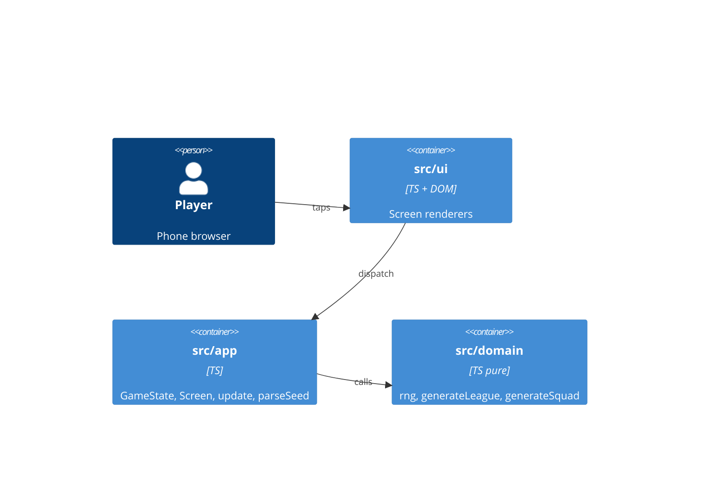

# Architecture brief (SSOT)

## Application Architecture
Functional core / imperative shell (ADR-0003), plain-DOM screens (ADR-0002), TypeScript/Vite/pnpm toolchain (ADR-0001), seed from `?seed=` (ADR-0004). Paradigm: functional (pure domain, immutable data), recorded in ADR-0003.

Dependencies point inward: ui -> app -> domain.

## For Acceptance Designer
Driving ports (black-box, via the browser at `/gaffer/` with an optional `?seed=N`):
- Title screen: `<h1>` "Gaffer" and button "New game".
- Pick-club screen: one `<h1>`, a list named "Clubs" with 8 `<li>`, each holding one `<button>` whose first text line is the club name.
- Club home screen: `<h1>` containing the club name.

In-process driving ports for unit/property tests: `generateLeague(seed)`, `parseSeed(search)`, `update(state, action)`.
Driven ports: none yet (no storage, no network). The URL is read once by the shell.
