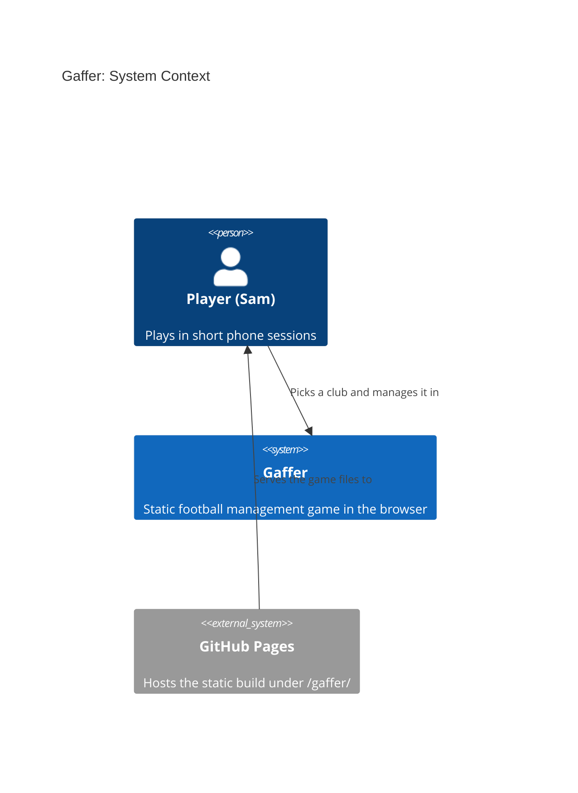
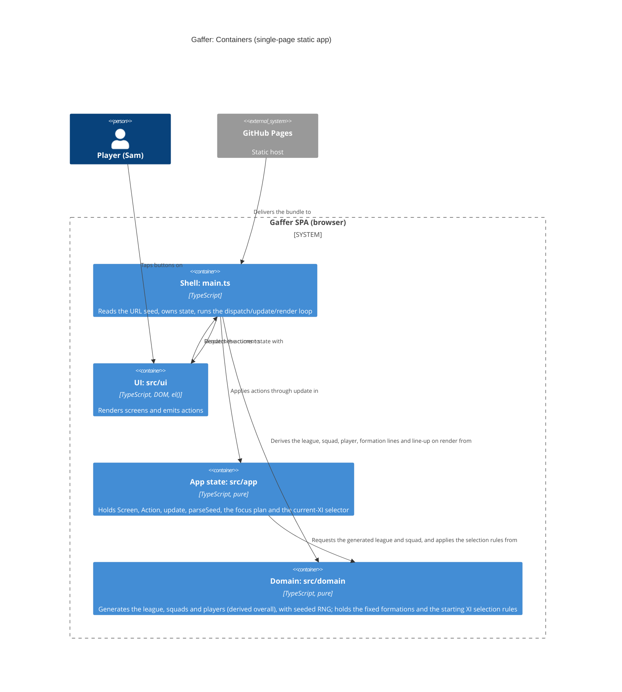

# Gaffer: architecture brief

SSOT for architecture. Decisions live in `adr-0001..0009`; this file shows how they fit together. Extend it per story.

## Application Architecture

### Drivers and constraints
Quality attributes, in order: determinism and replayability, phone usability and accessibility, testability, small bundle, simplicity. Bundle budget: no runtime dependencies; JS under 50 kB gzip (not yet enforced by CI; deferred).
Constraints: static site under `/gaffer/`, no backend, one solo team (no Conway conflict), OSS only (TypeScript, Vite, Vitest, fast-check, Playwright, oxlint, Stryker: all MIT or Apache-2.0).

### Style (ADR-0003)
Modular monolith, run as a functional core and imperative shell. This is the functional paradigm, and it is recorded here and in ADR-0003, not in CLAUDE.md.
Ports and adapters, in function-signature form:
- `src/domain/` is the pure core. Readonly data, no DOM, clock, storage, `Math.random` or `Date`. Randomness comes only from `rng.ts`.
- `src/app/` is the pure shell state: `GameState`, `Screen`, `Action`, `update`, `initialState`, `parseSeed`, `focusPlan` (S-004, in `state.ts`), `currentXI` (S-005, in `state.ts`).
- `src/ui/` holds the effectful DOM renderers, built with `el()` (ADR-0002).
- `src/main.ts` is the composition root. It reads `location.search` once, owns the current state, and runs the loop `dispatch` then `update` then `render`.
- Dependencies point inward only: ui, then app, then domain.

Rejected simpler alternative: no layering, with generation inline in the UI. It breaks Node-only property tests and determinism checks.

### Effect isolation (contract shapes)
| Component | Shape | Universe / assertion |
|---|---|---|
| `generateLeague`, `generateSquad`, `deriveOverall` (S-003), `createRng`, `nextFloat`, `deriveSeed` | pure, return-only | Deep-equal on repeat calls; input never mutated; fast-check property tests |
| `parseSeed`, `update`, `initialState`, `focusPlan` (S-004) | pure, return-only | Unit tests; `update` returns a new state and never mutates the old one; `focusPlan` returns a plan value (`heading` or `element{id}`), never touches the DOM |
| `domain/formation.ts` (S-004): `FORMATIONS`, `DEFAULT_FORMATION`, `isFormationId`, `formationLines`, `lineUp` | pure data constants and pure return-only functions | Deeply frozen (`Object.isFrozen` on the array, each lines array and each line object), no seed, no RNG; unit tests on counts, order and derivation; read-only ports expose no write methods |
| `domain/selection.ts` (S-005): `automaticXI`, `pickForSlot`, `playersForPosition`, `isSlotIndex` | pure, return-only | No RNG, no seed of its own; inputs never mutated; `pickForSlot` returns the same `xi` object for the slot's own player and `undefined` for an invalid pick; fast-check properties over seeds, all 8 clubs, all 3 formations, plus a golden XI |
| `currentXI`, `squadOf`, `withoutPicks` (S-005, `app/state.ts`) | pure, return-only | `currentXI` = stored `xi`, else `automaticXI(squad, formation)` (the only derivation of the effective XI); `withoutPicks` returns the same state when no `xi` is stored. Unit tests |
| `domain/names.ts` | pure data constants, return-only | Frozen word lists, towns, suffixes, palette; no functions with effects. Unit test: no duplicates in name/town lists |
| `ui/dom.ts` `el()` | bounded-change | Creates detached nodes only; never touches `document.body` or attached nodes |
| `render<Screen>` (incl. `renderSquad`, `renderPlayer`, `renderTactics`, `renderStartingXI`, `renderChoosePlayer`) | bounded-change | Writes only `root`'s children. Takes `(root, props, dispatch)` with `dispatch(action, focusId?)`, never `window` or `location`. Does not move focus (a unit test fails if `.focus(` appears under `src/ui/`); it may only name the id to refocus through `dispatch`'s optional second argument |
| `main.ts` | unbounded shell | Universe: reads `location.search` once; writes only `root`'s children (via render) and focus, as `focusPlan` says (the new `<h1>` with `tabindex="-1"` when the screen changed, else the element with the resolved `focusId`); no other globals. Covered by e2e |

Driving ports that only read expose no write methods: `generateLeague` and `parseSeed` return values and have no setters.

### Earned Trust (probes)
S-001 has no external adapters. The only environment dependency is `location.search`, read once and validated by `parseSeed`, which falls back to the default on any bad input (the probe equivalent: the unit test feeds `abc`, empty, `9999999999`, `1.5`). Storage will need a probe when persistence arrives (its own story).

### Enforcement
`.oxlintrc.json` forbids domain importing app or ui, app importing ui, and DOM/time use in domain. The PR guard rejects `Math.random`, `Date.now` and `new Date(` in `src/domain/`. Stryker mutates `src/domain/**` nightly.

### Domain model (S-001)
- `League`: `{ seed, clubs: readonly [8 Club] }`
- `Club`: `{ id, name, colours: readonly [Colour, Colour] }`; the colours are distinct and come from a fixed palette.
- Name uniqueness: 8 towns drawn without replacement from at least 24, plus a suffix that may repeat (ADR-0004).
- No external integrations, so no contract tests are needed.

### Component inventory (shipped in S-001)
| Component | Layer | Responsibility |
|---|---|---|
| `src/domain/rng.ts` | domain | Seeded draws (`createRng`, `nextFloat`) |
| `src/domain/names.ts` | domain | Frozen word lists: towns, suffixes, palette |
| `src/domain/league.ts` | domain | `generateLeague(seed)`: pure 8-club `League` |
| `src/app/seed.ts` | app | `parseSeed(search)`, `DEFAULT_SEED` |
| `src/app/types.ts` | app | Shared app types |
| `src/app/state.ts` | app | `GameState`, `Screen`, `Action`, `update`; from S-004 also `initialState` and the pure `focusPlan` / `FocusPlan`; from S-005 the optional `xi`, the `startingXI` / `choosePlayer` screens, three actions and the pure `currentXI` selector |
| `src/ui/dom.ts` | ui | `el()` safe element builder |
| `src/ui/screens/{title,pick-club,club-home}.ts` | ui | `render<Screen>(root, props, dispatch)`; `club-colours.ts` is a shared swatch helper |
| `src/domain/squad.ts` (S-002) | domain | `Player`, `generateSquad(seed, clubIndex)` |
| `src/ui/screens/squad.ts` (S-002, S-003) | ui | `renderSquad`: h1, "Squad" list (each row one button, dispatches `ViewPlayer`), "Back" button |
| `src/ui/screens/player.ts` (S-003) | ui | `renderPlayer`: h1 player name, Position/Age/Overall lines, "Attributes" list, "Condition" line, "Back" button |
| `src/domain/formation.ts` (S-004) | domain | `FormationId`, `FORMATIONS`, `DEFAULT_FORMATION`, `isFormationId`, `formationLines`, `lineUp` |
| `src/ui/screens/tactics.ts` (S-004) | ui | `renderTactics(root, { formation, lines }, dispatch)`: h1 "Tactics", radio group "Formation", list "Line-up", "Back" button |
| `src/domain/selection.ts` (S-005) | domain | `StartingXI`, `automaticXI`, `pickForSlot`, `playersForPosition`, `isSlotIndex` |
| `src/ui/screens/starting-xi.ts` (S-005) | ui | `renderStartingXI(root, { slots }, dispatch)`: h1 "Starting XI", list "Starting XI" of 11 slot buttons (dispatch `ChooseSlot`), "Back" button |
| `src/ui/screens/choose-player.ts` (S-005) | ui | `renderChoosePlayer(root, { position, players }, dispatch)`: h1 "Choose GK/DF/MF/FW", list "Players" (dispatch `PickPlayer`), "Back" button |
| `src/main.ts` | shell | Composition root, loop (`initialState`, `update`, render), derives `formationLines(formation)` for the tactics props and the squad, `currentXI` and `lineUp` for the Starting XI and choose-player props, resolves `focusId`, executes the `focusPlan` |

### Squad (S-002, ADR-0005)
- Domain: `Player { name, position: GK|DF|MF|FW, age, overall }` (S-003 adds `attributes` and `condition`); `generateSquad(seed, clubIndex) => readonly Player[]` in `src/domain/squad.ts`; `deriveSeed(seed, stream) => number` in `rng.ts`.
- Different players per club by construction: one league-wide draw of 144 names without replacement from `FIRST_NAMES x SURNAMES`, sliced per club (stream `deriveSeed(seed, -1)`). Name-list entries are single words; pools are frozen after S-002 (changes reshuffle all squads). `clubIndex` not an integer 0..7 throws `RangeError`. Quota 2/6/6/4, ages 17-35, overall 1-20 (stored in S-002; derived from attributes since S-003, see below).
- Squad is derived on render from `league.seed` and the club's index; it is not in `GameState`.
- App: `Screen` adds `{ kind: "squad", clubId }`; `Action` adds `ViewSquad` (clubHome to squad) and `Back` (squad to clubHome); both are no-ops from other screens.
- UI: `ui/screens/squad.ts` `renderSquad(root, club, squad, dispatch)`; `club-home.ts` gains a "Squad" button and takes `dispatch`.
- Contract shapes: `generateSquad`, `deriveSeed` pure return-only (deep-equal, property tests); `renderSquad` bounded-change (root's children only); read-only driving ports expose no setters. No new external adapters, so no new probe; the only environment input stays `location.search` (S-001).
- No external integrations, no contract tests. No new C4 container: the existing L2 holds (domain gains `squad.ts`; the "Requests the generated league from" arrow also carries squads).

### Player detail (S-003, ADR-0006)
- Domain: `Player { name, position, age, overall, attributes, condition }`. `attributes` is a readonly record of `goalkeeping | defending | passing | shooting`, integers 1-20; `ATTRIBUTE_ORDER` and `ATTRIBUTE_LABELS` (exported from `squad.ts`) fix the display order and labels. `condition` is an integer percentage, generated 75-100 (`CONDITION_MIN`, `CONDITION_MAX`), constant in this story.
- `overall` is derived, not drawn: `deriveOverall(position, attributes)` = round-half-up of a per-position weighted mean, in integer tenths (GK 7/1/2/0, DF 0/6/3/1, MF 0/2/5/3, FW 0/1/3/6 over goalkeeping/defending/passing/shooting). Weights are non-negative and sum to 10, so `min attribute <= overall <= max attribute`, always within 1-20.
- Generation: the club stream `deriveSeed(seed, clubIndex)` still draws age then a 1-20 internal `quality` (so names, positions, ages and order are unchanged from S-002); attributes (quality plus a position offset plus noise -2..+2, clamped 1-20) and condition come from `deriveSeed(seed, 100 + clubIndex)`, five draws per player. Stream numbers in use: -1 names, 0..7 clubs, 100..107 attributes. Overall values differ from S-002 (no persistence; accepted).
- App: `Screen` adds `{ kind: "player", clubId, playerIndex }`; `Action` adds `{ type: "ViewPlayer", playerIndex }`, valid only from `squad` with a known club and an integer index 0..17, else a no-op. `Back`: player to squad (same club), squad to clubHome; no-op elsewhere. The player is derived on render (`generateSquad(league.seed, clubIndex)[playerIndex]`), not stored.
- UI: squad rows are `<li>` holding one `<button>` (the same four spans, 44px or taller); `renderPlayer(root, player, dispatch)` in `ui/screens/player.ts`. Label and value read on one line with a single space ("Position GK", "Goalkeeping 14", "Condition 92%"): inline flow only, no flex or grid on the pairs. Any attribute bar is a CSS pseudo-element (no DOM node, no text).
- Contract shapes: `generateSquad`, `deriveOverall`, `update` pure return-only; `renderPlayer`/`renderSquad` bounded-change (root's children only). No new adapters, so no new probe; no new C4 container.

### Tactics (S-004, ADR-0007, ADR-0008)
- Domain: new `src/domain/formation.ts`, pure and frozen, no seed. `FormationId = "4-4-2" | "4-3-3" | "4-2-3-1"`, `FORMATIONS` (that order), `DEFAULT_FORMATION = "4-4-2"`, `isFormationId`. Source of truth is a line structure (`{ position, count }` lines, GK first): 4-4-2 = GK 1, DF 4, MF 4, FW 2; 4-3-3 = GK 1, DF 4, MF 3, FW 3; 4-2-3-1 = GK 1, DF 4, MF 2, MF 3, FW 1. `isFormationId(value: string): value is FormationId` is a type guard. All data is deeply frozen (outer array, each lines array, each `FormationLine`). `formationLines(f)` feeds the layout (grouping slots into pitch rows); `lineUp(f) => readonly Position[]` (11 codes, GK, DF, MF, FW order) is derived from it. `Position` is reused from `squad.ts`. From `salvage/tactics.ts` only the names are ported (no coordinates, no finer roles, no mentality). S-005 treats a slot as its index in `lineUp(formation)`.
- App: `GameState` gains `formation: FormationId`; `initialState(league)` (title, 4-4-2) replaces the literal in `main.ts`; `NewGame` also resets `formation` (unneeded today, kept deliberately as future-proofing for "Save and continue" or "play again"). `Screen` adds `{ kind: "tactics", clubId }`. `Action` adds `ViewTactics` (clubHome of a known club only) and `ChooseFormation { formation }` (tactics of a known club and a known id only; else a no-op; the current formation returns the same state object; only `formation` changes). `Back`: tactics to clubHome (known club), else a no-op. The formation is not in the screen, so it survives Back, Squad, a player and Back; the line-up is derived on render.
- Focus (ADR-0008): the dispatch contract is `dispatch(action, focusId?: string)` (optional second argument; existing renderers unchanged). `focusPlan(previous, next, focusId)` (pure, in `src/app/state.ts`, so it is inside Stryker's existing `mutate` glob) returns `heading` when the `Screen` changed (or on first render), `element{id}` when the screen is the same and a `focusId` is given, else `heading`. `main.ts` takes `focusId` from the dispatch's argument only (no `document.activeElement` read) and executes the plan after the render (the element is looked up in the new DOM, falling back to the `<h1>`); renderers still never move focus. Controls that must keep focus carry stable data-derived ids (`formation-4-4-2`, `formation-4-3-3`, `formation-4-2-3-1`). The radios dispatch from `change` with their own id: `dispatch({ type: "ChooseFormation", formation }, "formation-<id>")`. Focus is on the tapped radio in Chromium (probed by e2e and the protected scenarios); iOS Safari is expected to behave the same, because programmatic focus on a native radio works there, but it is not probed in CI (an unprobed assumption). The radio node is re-created by the re-render and focus is restored to the new node in the same task, so one render path is kept (an in-place patch was rejected: two code paths for one screen).
- UI: `renderTactics(root, { formation, lines }, dispatch)` in `ui/screens/tactics.ts` (bounded-change); `main.ts` derives `lines = formationLines(formation)` and passes it (the renderer imports domain types only, as S-002/S-003; it expands `lines` into the 11 items, which equals `lineUp(formation)`). Markup: one `<h1 tabindex="-1">Tactics</h1>`; `
` with a visible `
Formation
` (a non-heading element, as is `
Line-up
` below, so the screen keeps exactly one heading; not a fieldset, so the group name does not depend on legend handling); per formation a `<label>` holding a native `<input type="radio" name="formation" id="formation-<id>" value="<id>">`, an `aria-hidden` empty `` for the visual mark, and the formation name as a direct text node of the label (accessible name and visible text equal "4-4-2"); `checked` set on the one in state. CSS constraints: the radio input is never `display: none`, `visibility: hidden` or given the `hidden` attribute (it must stay in the accessibility tree and keyboard order); it is stretched over the label with `opacity: 0` (absolute, full size), and the label is `display: block`, `position: relative`, `min-height: 48px`. So the label and the input are both 48px tall and a tap anywhere on the card checks the native radio; focus ring shows on the mark. `<ul role="list" aria-labelledby="lineup-label">` (visible `
Line-up
`) with exactly 11 `<li>`, each `textContent` exactly its code, in `lineUp` order. A `back-button` "Back" (48px). Rejected for the group: `<fieldset>` with `<legend>` (name and role rely on implicit mapping), `<select>` (no radio role; outcome says radios).
- Line-up layout: one flat `<ul>` (no nested lists, so exactly 11 `listitem`s) as a CSS grid of 12 columns. Each `<li>` carries `style="--span: k"` (attribute-only through `el()`), where `k` is 12 divided by its line's count (from `formationLines`), so 3, 4, 6 or 12; numbers only, never generated text. The CSS is `grid-column: span var(--span)`; because each line's spans sum to 12, auto-placement fills one pitch row per line in DOM order, so no explicit row is needed (4-2-3-1 gives two MF rows of 2 and 3). Visual order equals DOM order: GK row first (top), then DF, MF lines, FW row last (bottom; the team attacks downward), which is also what assistive tech reads. Pitch green panel, chalk lines, gold position codes (scope.md identity). Sizing: no horizontal scroll at 390px (4 slots per row at most).
- Club home: the "Tactics" button goes after "Squad" in a `div.club-actions` (single-column grid, gap 8px, full width, 48px); both buttons stack. Existing tests find "Squad" by name only.
- Contract shapes and probes: see the effect-isolation table; the focus assumption is probed by e2e (tap, arrow key). No external integrations, no contract tests, no new C4 container (domain gains `formation.ts`, `state.ts` gains `focusPlan`; the L2 holds, descriptions updated).

### Starting XI (S-005, ADR-0009)
- Domain: new pure `src/domain/selection.ts` (new small "Selection" context over squad and formation; no RNG, no seed of its own). `StartingXI = readonly number[]`, 11 squad indices in slot order, where slot `i` is index `i` of `lineUp(formation)` (ADR-0007). `isSlotIndex(value)` accepts integers 0..10. `automaticXI(squad, formation)`: per position, indices ranked by overall descending, ties by squad index ascending, dealt to that position's slots in `lineUp` order (positions are contiguous, so starters read highest first; the quota 2/6/6/4 covers every formation). `playersForPosition(squad, position)`: that position's indices in squad order. `pickForSlot({ squad, formation, xi }, slot, playerIndex)` (3 parameters, oxlint `max-params`): `undefined` for an invalid slot, an index outside integers 0..17 or a player of another position; the same `xi` object for the slot's own player; else a new array that swaps (player already in slot `j`) or replaces. Golden: seed 31, club 0, 4-4-2 is `[0, 7, 3, 6, 2, 9, 12, 8, 10, 17, 14]`.
- App: `GameState` gains `readonly xi?: StartingXI | undefined`. Absent or `undefined` means never changed: the effective XI is `currentXI(state, squad)` = stored `xi`, else `automaticXI(squad, formation)`, derived on demand as the squad is (ADR-0005 (d)). `initialState` is unchanged. Rejected: `xi: StartingXI | null`, because `initialState` would gain `xi: null` and vitest `toEqual` treats a `null` key as different from a missing one, which would fail `tests/acceptance/S-004/tactics-navigation.test.ts` (`initialState` equality) and the literal whole states in `tests/acceptance/S-003/player-navigation.test.ts` (the DoD forbids editing them). The private `withoutPicks(state)` returns the same state when nothing is stored, else `{ ...state, xi: undefined }`. `ChooseFormation` (guards unchanged) returns `{ ...withoutPicks(state), formation }`, which is exactly `{ ...state, formation }` for an XI never changed. `NewGame` also drops a stored XI.
- Navigation: `Screen` adds `startingXI{clubId}` and `choosePlayer{clubId, slot}`. `Action` adds `ViewStartingXI` (clubHome of a known club only), `ChooseSlot{slot}` (startingXI of a known club, `isSlotIndex`) and `PickPlayer{playerIndex}` (choosePlayer of a known club and valid slot). `update` derives the squad with the exported `squadOf(league, clubId)` (club index = position in `league.clubs`; `undefined` for an unknown club; also used by `main.ts`'s two new cases, so there is one lookup) and calls `pickForSlot` on `currentXI`. `NewGame` keeps its title-only guard. `xi` is never stale across clubs: `pickClub` is reachable only through `NewGame`, which drops it. `undefined` is a no-op (stays on choose). The same object means the own player: back to startingXI with no `xi` stored. Otherwise back to startingXI with `xi` set. `Back`: choosePlayer to startingXI (known club, valid slot), startingXI to clubHome (known club), else a no-op. `focusPlan`'s `sameScreen` adds startingXI (by `clubId`) and choosePlayer (by `clubId` and `slot`). Every new navigation changes the screen, so focus goes to the new `<h1>` (ADR-0008) and no focus ids are added.
- UI: the club home's `div.club-actions` gains a third `button.primary` "Starting XI" after "Tactics" (stacked, 48px). `renderStartingXI(root, { slots }, dispatch)`, with `slots` = `{ position, player }` per slot as derived by `main.ts`: `<h1 id="starting-xi-title" tabindex="-1">Starting XI</h1>`; `<ul role="list" aria-labelledby="starting-xi-title">` (the list name comes from the heading, one source) with 11 `<li>`, each holding one `<button type="button" class="xi-slot">`; a `.back-button` "Back". `renderChoosePlayer(root, { position, players }, dispatch)`, with `players` = `{ playerIndex, name, overall, starting }` in squad order (`playersForPosition`; `starting` = in `currentXI`): `<h1 tabindex="-1">Choose MF</h1>`; `<ul role="list" aria-label="Players">` with one `<li>` and one `<button type="button" class="xi-choice">` per player; a `.back-button` "Back". Button text is inline spans separated by literal single-space text nodes (code, " ", name, " ", overall; name, " ", overall[, " ", "Starting"]), so `textContent` and the accessible name read exactly "MF Ivo Elderkin 18" and "Ivo Elderkin 18 Starting". No flex, grid or float on these buttons or their spans: blockified children would drop the space nodes and make `innerText` read "MF\nIvo Elderkin\n18" (the S-003 inline-flow rule above; squad-row markup is not reused). `main.ts`'s `render` switch gets a `never`-typed exhaustiveness guard. The buttons are `display: block`, full width, `min-height: 48px`, left-aligned and `overflow-wrap: anywhere`, so long names wrap with no sideways scroll at 390px. Layout: one flat stacked list (pitch-row chips were rejected: about 80px per name at 358px).
- Contract shapes: see the effect-isolation table. No new adapter, so no adapter probe. The environment assumption (layout and accessible name) is probed by the e2e: exact names, `textContent` and `innerText` equality (including "DF Ulric O'Garrity 8" and "FW Finlay Fitch-Moreton 5") and a scroll-width check. Faults: missing space nodes turn the name and `textContent` checks red; a grid or flex button turns the `innerText` check red. No external integrations, no contract tests, no new C4 container (domain gains `selection.ts`; the L2 holds, descriptions updated).

### C4 level 1: System context

### C4 level 2: Container

### Technology
No new technology. ADR-0001 (toolchain), ADR-0002 (plain DOM), ADR-0004 (seed and world), ADR-0005 (squad generation, S-002), ADR-0006 (attributes, condition, derived overall, S-003), ADR-0007 (formation data and tactics state, S-004), ADR-0008 (focus on a same-screen update, S-004) and ADR-0009 (starting XI selection rules and state, S-005) cover it. Decisions live in `adr-0001..0009`.

### Platform handoff notes
No external integrations. No contract tests. The `ci:*` contract is unchanged.

## For Acceptance Designer

Black-box target: `http://localhost:4173/gaffer/` (`ci:serve`). Pin the seed with `?seed=<int>`.

### Driving ports (S-001)
1. **Domain: `generateLeague(seed: number) => League`** (pure, `src/domain/`).
   - For any 32-bit seed: 8 clubs, unique non-empty names, 2 distinct colours each.
   - The same seed gives deep-equal output. Seeds 1 and 4242 differ.
   - No name is on the real-club denylist (`tests/unit/fixtures/real-club-denylist.ts`).
2. **Shell: seed parsing, `parseSeed(search: string) => number`** (pure, `src/app/`).
   - `^-?\d{1,10}$` within signed 32-bit: used as is, and `007` gives 7.
   - Missing, empty, `abc`, `1.5` and `9999999999` give `DEFAULT_SEED`.
   - Shell: `update(state, action) => state` with `Screen` = `title | pickClub | clubHome{clubId}`. "New game" moves title to pickClub. "Choose club" moves pickClub to clubHome. The chosen club is in memory only.
3. **UI: DOM via roles and accessible names** (Playwright, Pixel 7 / 390px viewport).

### UI contract
| Screen | Contract |
|---|---|
| Title | One `<h1>` "Gaffer"; `button` named "New game" |
| Pick club | One `<h1>` "Choose your club"; a `list` named "Clubs" (`aria-labelledby` on the h1) with exactly 8 `listitem`s, each holding exactly 1 `button`. The first line of the button text is the club name; the swatch is `aria-hidden`. Buttons are 44px or taller. |
| Club home | One `<h1>` containing the chosen club's name |

Cross-cutting: the shell (`main.ts`, not the renderers) moves focus to the new `<h1>` (`tabindex="-1"`) after navigation. There is no horizontal scroll at 390px and no console errors. Generated text is set with `textContent`, never `innerHTML`.

### Driving ports (S-002)
4. **Domain: `generateSquad(seed: number, clubIndex: number) => readonly Player[]`** (pure, `src/domain/squad.ts`); `clubIndex` 0..7, else `RangeError`.
   - 18 players: exactly 2 GK, 6 DF, 6 MF, 4 FW, in that position order. `age` integer 17-35 (accept 16-40 in UI), `overall` integer 1-20.
   - Same `(seed, clubIndex)` gives deep-equal output. Across `clubIndex` 0..7 of one seed all 144 names are distinct; names have no digits.
   - No name in the pool is on the real-player denylist (`tests/unit/fixtures/real-player-denylist.ts`).
5. **Domain: `deriveSeed(seed: number, stream: number) => number`** (pure, `rng.ts`): signed 32-bit integer, deterministic, differs across streams for typical seeds.
6. **Shell: `update`** with `Screen` adding `squad{clubId}`; `ViewSquad` moves clubHome to squad, `Back` moves squad to clubHome (same `clubId`). Both leave state unchanged from any other screen.
7. **UI** (roles and accessible names, 390px):

| Screen | Contract |
|---|---|
| Club home | Adds a `button` named "Squad" (44px or taller); `<h1>` is still the club name |
| Squad | One `<h1>`; `<h1>` text = the club name; a `list` with `aria-label="Squad"` and exactly 18 `listitem`s ~~, not buttons~~ (superseded by S-003, ADR-0006: each listitem holds exactly one `button`, 44px or taller); row text order: name, position, age, overall (age and overall are the first two numbers); `button` named exactly "Back" (44px or taller) returns to club home |

### Driving ports (S-003)
8. **Domain: `generateSquad(seed, clubIndex) => readonly Player[]`** (extended; same signature and `RangeError` rule as port 4).
   - Everything in port 4 still holds, except `overall` is derived. Each `Player` also has `attributes` (keys `goalkeeping`, `defending`, `passing`, `shooting`, each an integer 1-20) and `condition` (integer; generated 75-100, so always within 0-100).
   - `overall` equals `deriveOverall(position, attributes)` and `min(attributes) <= overall <= max(attributes)`; it is an integer 1-20.
   - Same `(seed, clubIndex)` gives deep-equal output, attributes and condition included. Names, positions and ages for a seed are the same as in S-002 (ADR-0006 determinism note). The 18 players of one squad do not all share the same attribute values (property over many seeds and clubs).
   - `ATTRIBUTE_ORDER` is `goalkeeping, defending, passing, shooting`; `ATTRIBUTE_LABELS` are `Goalkeeping`, `Defending`, `Passing`, `Shooting`. `deriveOverall(position, attributes) => number` is pure and exported.
9. **Shell: `update`** with `Screen` adding `player{clubId, playerIndex}`; `Action` adding `ViewPlayer{playerIndex}`.
   - `ViewPlayer` moves squad to player (same `clubId`, given `playerIndex`) only when the club is known and `playerIndex` is an integer 0..17; otherwise state is unchanged (also unchanged from title, pickClub, clubHome and player).
   - `Back` moves player to squad (same `clubId`) and squad to clubHome; from the player screen with an unknown club or an invalid index, and from title/pickClub/clubHome, it leaves state unchanged. No input is mutated.
10. **UI** (roles and accessible names, 390px):

| Screen | Contract |
|---|---|
| Squad rows (S-003) | In the list "Squad": 18 `listitem`s, each holding exactly 1 `button`, 44px or taller. Button text is name, position, age, overall as before (age and overall the first two numbers). Tapping row N opens that squad's player N |
| Player | Exactly one `<h1>`: the player's name (focused after navigation). Visible lines "Position GK|DF|MF|FW", "Age N", "Overall N", each label and value reading together on one line, values equal to the tapped row. A `list` named "Attributes" with exactly 4 `listitem`s, "Goalkeeping N", "Defending N", "Passing N", "Shooting N" in that order, N an integer 1-20 and no other number in the item. Outside that list, "Condition N%" (integer 0-100). `overall` is between the lowest and highest N. A `button` named exactly "Back" (44px or taller) returns to the same club's squad (heading = club name, 18 rows); "Back" there returns to club home. Same seed, club and row give an identical screen on every visit |

Cross-cutting (unchanged): no horizontal scroll at 390px (long names wrap), no console errors, generated text via `textContent`.

### Driving ports (S-004)
11. **Domain: formation data** (pure, `src/domain/formation.ts`): `FORMATIONS` is exactly `4-4-2`, `4-3-3`, `4-2-3-1` in that order; `DEFAULT_FORMATION` is `4-4-2`; `lineUp(formation) => readonly Position[]` has 11 codes, each GK, DF, MF or FW, one GK first, then DF, MF, FW (non-decreasing in that order), with counts GK/DF/MF/FW of 1/4/4/2, 1/4/3/3 and 1/4/5/1 (4-2-3-1 has no finer split: its midfield is 5 `MF`). `formationLines(formation)` expands to the same 11 codes. Data is deeply frozen (outer array, lines arrays and every line object) and independent of any seed; `isFormationId(value: string): value is FormationId` accepts only those three strings.
12. **Shell: `update`** with `Screen` adding `tactics{clubId}`, `GameState` adding `formation`, `Action` adding `ViewTactics` and `ChooseFormation{formation}`; `initialState(league)` has screen title and formation `4-4-2`.
    - `ViewTactics` moves clubHome of a known club to tactics (same `clubId`); from title, pickClub, squad, player, tactics or an unknown club the state is unchanged.
    - `ChooseFormation` on tactics of a known club with a known id returns the state with only `formation` changed; the same formation returns the same object; any other screen, an unknown club or an unknown id (`"3-5-2"`, `""`) leaves the state unchanged. `NewGame` from title sets `formation` to `4-4-2`.
    - `Back` moves tactics to clubHome (same `clubId`); an unknown club leaves state unchanged. The formation survives clubHome, squad, player and back to tactics. No input is mutated.
13. **Shell: `focusPlan(previous, next, focusId)`** (pure, `src/app/state.ts`): heading when `previous` is undefined or a different screen (any field differs); `element` with the id when the screen is the same and `focusId` is a non-empty string; heading when the screen is the same and there is no id. The shell passes `focusId` = the dispatch's optional second argument, else none.
14. **UI** (roles and accessible names, 390px; the screen is reached from the club home):

| Screen | Contract |
|---|---|
| Club home | Adds a `button` named exactly "Tactics" (44px or taller) after "Squad" (stacked); `<h1>` is still the club name |
| Tactics | Exactly one `<h1>` "Tactics", focused after arriving. A `radiogroup` named "Formation" holds exactly 3 `radio`s named "4-4-2", "4-3-3", "4-2-3-1" in that order (native `input type="radio"`), exactly one checked ("4-4-2" in a new game, the chosen one otherwise). Each label (the text of the formation name) is 44px or taller and tapping it checks its radio. The labels "Formation" and "Line-up" are non-heading elements (`
` referenced by `aria-labelledby`). The radio inputs stay in the accessibility tree (never `display: none`, `visibility: hidden` or `hidden`). A `list` named "Line-up" with exactly 11 `listitem`s, each text exactly one of GK, DF, MF, FW, in `lineUp` order (drawn top to bottom in that order, GK row first), no other text. A `button` named exactly "Back" (44px or taller) returns to the club home (heading = club name) |
| Choosing | After tapping a formation (or pressing an arrow key on a focused radio): only that radio is checked, "Line-up" shows its codes at once, the only heading is still "Tactics", and the `document.activeElement` is the tapped radio (not the `<h1>`; probed on Chromium, iOS Safari expected but not probed in CI). Tapping the checked one changes nothing. Taps on "Back", "Squad", a row and "Back" still focus the new `<h1>` |

Cross-cutting (unchanged): no horizontal scroll at 390px on club home and tactics, no console errors, generated text via `textContent`.

### Driving ports (S-005)
15. **Domain: selection rules** (pure, `src/domain/selection.ts`; no RNG, no seed of its own; inputs never mutated). `StartingXI = readonly number[]` (11 squad indices in slot order; slot `i` reads code `lineUp(formation)[i]`).
    - `isSlotIndex(value)`: true exactly for integers 0..10.
    - `automaticXI(squad, formation)`: for any seed, club 0..7 and formation, 11 distinct integers 0..17; `squad[xi[i]].position === lineUp(formation)[i]`; within a position, overall non-increasing and ties in ascending squad index; no player of a position outside the XI has a higher overall than a starter of that position. Same inputs give deep-equal output. Golden: seed 31, club 0, 4-4-2 is `[0, 7, 3, 6, 2, 9, 12, 8, 10, 17, 14]`. The 4-3-3 and 4-2-3-1 rows of DISCUSS US-1 are further goldens.
    - `playersForPosition(squad, position)`: that position's squad indices in squad order (2 GK, 6 DF, 6 MF, 4 FW).
    - `pickForSlot({ squad, formation, xi }, slot, playerIndex)`: `undefined` when `slot` is not a slot index (-1, 11, 1.5, NaN), `playerIndex` is not an integer 0..17 (-1, 18, 1.5, NaN), or the player's position differs from the slot's code. It returns the same `xi` object for the slot's own player. Otherwise it returns a new array with the player in `slot`: a replace changes exactly that slot, and a swap (the player held slot `j`) changes exactly `slot` and `j`. The result is always 11 distinct indices with matching positions. Picking the displaced player back into `slot` restores the input.
16. **Shell: `update`** with `Screen` adding `startingXI{clubId}` and `choosePlayer{clubId, slot}`, `Action` adding `ViewStartingXI`, `ChooseSlot{slot}` and `PickPlayer{playerIndex}`, and `GameState` adding the optional `xi` (absent = never changed); plus `currentXI(state, squad)` (stored `xi`, else `automaticXI(squad, state.formation)`) and `squadOf(league, clubId)` (the club's generated squad, `undefined` for an unknown club).
    - `initialState(league)` is unchanged (no `xi` key). `ViewStartingXI` moves clubHome of a known club to startingXI (same `clubId`). From any other screen or an unknown club, the state is unchanged.
    - `ChooseSlot` moves startingXI (known club) to choosePlayer with that slot when `slot` is an integer 0..10. Otherwise, on another screen, or with an unknown club, the state is unchanged.
    - `PickPlayer` on choosePlayer (known club, valid slot): an eligible player not in the XI, or a starter of another slot, gives startingXI with `xi` set to the new XI (replace or swap). The slot's own player gives startingXI with no `xi` key added when none was stored. A player of another position, an index outside integers 0..17, another screen or an unknown club leaves the state unchanged.
    - `Back`: choosePlayer to startingXI (same club, `xi` unchanged), startingXI to clubHome. An unknown club or an invalid slot leaves the state unchanged.
    - `ChooseFormation` (guards unchanged): with no stored `xi`, exactly `{ ...state, formation }` (the S-004 suite is unedited and green); with a stored `xi`, `formation` changes and `xi` is `undefined` (so `currentXI` is the new formation's automatic XI). The same formation returns the same object, so `xi` is kept. `NewGame` from title drops a stored `xi`. The XI survives Back, Squad, a player, Back, Tactics without a change, and Back. No input is mutated.
17. **Shell: `focusPlan`** (extended): startingXI vs startingXI of the same club is the same screen; choosePlayer is the same screen only with the same `clubId` and `slot`. Every S-005 navigation (club home to startingXI, slot to choosePlayer, pick or Back to startingXI, Back to club home) is a screen change, so the plan is `heading`.
18. **UI** (roles and accessible names, 390px; reached from the club home):

| Screen | Contract |
|---|---|
| Club home | Adds a `button` named exactly "Starting XI" (44px or taller) after "Tactics" (stacked); `<h1>` is still the club name; "Squad" and "Tactics" unchanged |
| Starting XI | Exactly one `<h1>` "Starting XI", focused on arrival and on every return. A `list` named "Starting XI" (`aria-labelledby` the `<h1>`) with exactly 11 `listitem`s, each holding exactly 1 `button` (44px or taller) whose accessible name and `textContent` read exactly "CODE Name OVERALL" with single spaces (for example "MF Ivo Elderkin 18"). Codes follow `lineUp(formation)` order, and the overall is the only number. A `button` named exactly "Back" (44px or taller) returns to the club home (heading = club name, focused) |
| Choose player | Exactly one `<h1>` "Choose GK", "Choose DF", "Choose MF" or "Choose FW" (the tapped slot's code), focused on arrival. A `list` named "Players" with one `listitem` and one `button` (44px or taller) per squad player of that position, in squad order, reading exactly "Name OVERALL", or "Name OVERALL Starting" for players in the XI. Exactly as many read "Starting" as the formation has slots of that position. No age, attributes or condition. A `button` named exactly "Back" (44px or taller) returns to the Starting XI, unchanged, heading focused |
| Picking | Tapping a player shows the Starting XI (heading focused) with that player in the tapped slot: a non-starter replaces the slot's player, a starter of another slot swaps with it, and the slot's own player changes nothing. There are always 11 different players. After Back, Squad, a player, Back, Back, Tactics, the checked formation, Back and Starting XI, the 11 buttons are unchanged. After another formation is chosen, they show that formation's automatic XI |

Cross-cutting: no horizontal scroll at 390px on club home, Starting XI and choose player (long names wrap inside the button); no console errors; generated text via `textContent`; renderers never call `.focus()`. No generated name contains any of "Back", "Squad", "Tactics", "Starting", "Players", "Formation", "Line-up", "Clubs" or "Choose", as case-insensitive substrings (the DISCUSS D12 unit check over every string array in `names.ts`). The only new fixed names are "Starting XI", "Players", "Back" and the "Choose X" headings, each on its own screen. Slot and player buttons are checked for `innerText` as well as their exact name.

### Observable acceptance (behavioural)
- S-005: from the club home, "Starting XI" opens one heading "Starting XI" (focused) and a list "Starting XI" of 11 one-button items. At `?seed=31` on "Netherwold Borough" they read "GK Tamsin Ingleby 17", "DF Bram Pemberly 19", "DF Calder Ashcombe 18", "DF Quill Crossley 4", "DF Quill Yarrow 3", "MF Ivo Elderkin 18", "MF Joren Dalrymple 16", "MF Calder Redfern 15", "MF Dorian Dunmore 7", "FW Merrick Hartwell 8", "FW Garrick Thistlewood 5" (ties in squad order). An XI never changed follows the formation (4-3-3 at `?seed=31`, 4-2-3-1 at `?seed=abc` on "Oakhampton Rise Borough"). Tapping "MF Dorian Dunmore 7" shows "Choose MF" (focused) with a list "Players" of 6 in squad order, 4 marked "Starting". "Kestrel Northcott 6" fills the 9th slot. "MF Ivo Elderkin 18" then "Joren Dalrymple 16 Starting" swaps the 6th and 7th. The own player and the choose screen's "Back" change nothing. Picks survive Squad and Tactics visits without a formation change. Another formation gives its automatic XI. A fresh page and "New game" give the automatic XI. All buttons are 44px or taller, with no sideways scroll or console errors at 390px. 1 tap to see the XI and 2 taps per change from it.
- S-004: from the club home, "Tactics" opens one heading "Tactics" (focused), a group "Formation" with radios "4-4-2", "4-3-3", "4-2-3-1" in that order, only "4-4-2" checked in a new game, and a list "Line-up" of 11 items GK, 4 DF, 4 MF, 2 FW; tapping "4-3-3" (a label 44px or taller) checks only it and shows GK, 4 DF, 3 MF, 3 FW at once with the heading unchanged and focus on the "4-3-3" radio; `?seed=abc`, 8th club and `?seed=31` give the same line-ups, 1/4/5/1 for "4-2-3-1"; "Back" shows the club name, and after "Squad", "Back", "Tactics" the choice is still checked with its line-up; a fresh visit and "New game" shows "4-4-2"; "Tactics" and "Back" are 44px or taller; no sideways scroll or console errors at 390px; a formation is chosen in 2 taps from the club home and "Back" is 1 tap.
- S-003: from the squad, tapping any of the 18 rows opens a screen whose only heading is the player's name, with Position/Age/Overall equal to the row, a list "Attributes" of Goalkeeping, Defending, Passing, Shooting (1-20, in order, no other number), "Condition N%" outside it, and overall within the lowest and highest attribute; "Back" returns to the same squad (18 rows) and "Back" again to club home; the same `?seed=` and row give an identical screen; the 18 players do not all share attributes; `?seed=abc`, 8th club, first row (GK) and last row (FW) both open; each row has exactly one button of 44px or more; no sideways scroll or console errors at 390px; Squad to player is 1 tap and back is 1 tap.
- S-002: club home to "Squad" shows 18 rows; every row is name, position in GK/DF/MF/FW, age 16-40, overall 1-20; the quota is 2/6/6/4; two clubs of one league share no name; `?seed=31` twice gives identical rows in identical order; "Back" shows the club name as heading; no horizontal scroll or console errors at 390px; Squad is reached in 1 tap from club home.
- S-001 (below):
- Title to "New game" shows the heading and the 8-club list.
- Tapping any club (all 8, not a sample) gives an `<h1>` containing its name.
- The same `?seed=` on two fresh visits gives identical lists; seeds 1 and 4242 give different lists.
- An invalid seed gives the same list as no seed (unit-level).
- A tap count of 2 from load to club home.
