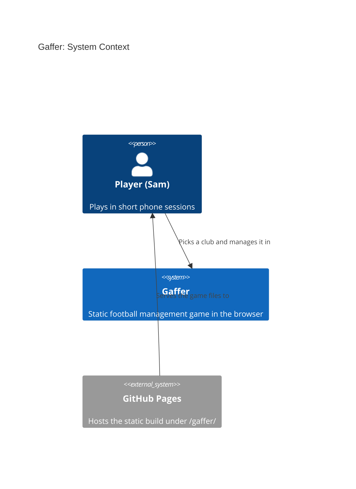
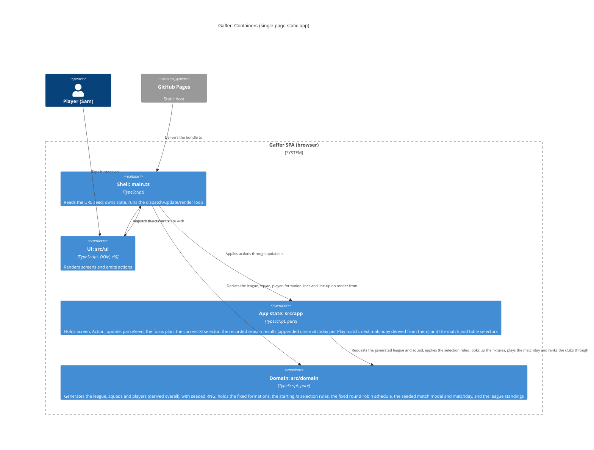

# Gaffer: architecture brief

SSOT for architecture. Decisions live in `adr-0001..0014`; this file shows how they fit together. Extend it per story.

## Application Architecture

### Drivers and constraints
Quality attributes, in order: determinism and replayability, phone usability and accessibility, testability, small bundle, simplicity. Bundle budget: no runtime dependencies; JS under 50 kB gzip (not yet enforced by CI; deferred).
Constraints: static site under `/gaffer/`, no backend, one solo team (no Conway conflict), OSS only (TypeScript, Vite, Vitest, fast-check, Playwright, oxlint, Stryker: all MIT or Apache-2.0).

### Style (ADR-0003)
Modular monolith, run as a functional core and imperative shell. This is the functional paradigm, and it is recorded here and in ADR-0003, not in CLAUDE.md.
Ports and adapters, in function-signature form:
- `src/domain/` is the pure core. Readonly data, no DOM, clock, storage, `Math.random` or `Date`. Randomness comes only from `rng.ts`.
- `src/app/` is the pure shell state: `GameState`, `Screen`, `Action`, `update`, `initialState`, `parseSeed`, `focusPlan` (S-004, in `state.ts`), `currentXI` (S-005, in `state.ts`), from S-007 the recorded results plus `playOpeningMatchday`, `matchFor` and `standingsOf` (in `state.ts`), and from S-008 `nextMatchday` and `playMatchdayFor` (in `state.ts`; ADR-0014).
- `src/ui/` holds the effectful DOM renderers, built with `el()` (ADR-0002).
- `src/main.ts` is the composition root. It reads `location.search` once, owns the current state, and runs the loop `dispatch` then `update` then `render`.
- Dependencies point inward only: ui, then app, then domain.

Rejected simpler alternative: no layering, with generation inline in the UI. It breaks Node-only property tests and determinism checks.

### Effect isolation (contract shapes)
| Component | Shape | Universe / assertion |
|---|---|---|
| `generateLeague`, `generateSquad`, `deriveOverall` (S-003), `createRng`, `nextFloat`, `deriveSeed` | pure, return-only | Deep-equal on repeat calls; input never mutated; fast-check property tests |
| `parseSeed`, `update`, `initialState`, `focusPlan` (S-004) | pure, return-only | Unit tests; `update` returns a new state and never mutates the old one; `focusPlan` returns a plan value (`heading` or `element{id}`), never touches the DOM |
| `domain/formation.ts` (S-004): `FORMATIONS`, `DEFAULT_FORMATION`, `isFormationId`, `formationLines`, `lineUp` | pure data constants and pure return-only functions | Deeply frozen (`Object.isFrozen` on the array, each lines array and each line object), no seed, no RNG; unit tests on counts, order and derivation; read-only ports expose no write methods |
| `domain/selection.ts` (S-005): `automaticXI`, `pickForSlot`, `playersForPosition`, `isSlotIndex` | pure, return-only | No RNG, no seed of its own; inputs never mutated; `pickForSlot` returns the same `xi` object for the slot's own player and `undefined` for an invalid pick; fast-check properties over seeds, all 8 clubs, all 3 formations, plus a golden XI |
| `currentXI`, `squadOf`, `withoutPicks` (S-005, `app/state.ts`) | pure, return-only | `currentXI` = stored `xi`, else `automaticXI(squad, formation)` (the only derivation of the effective XI); `withoutPicks` returns the same state when no `xi` is stored. Unit tests |
| `domain/schedule.ts` (S-006, ADR-0010): `fixturesOf`, `fixtureOf`, `MATCHDAYS`, `FIXTURES_PER_MATCHDAY` | pure data constant (deeply frozen table) and pure return-only functions | No seed, no RNG; goldens, `Object.isFrozen` at each level, perfect-matching and double round-robin properties |
| `domain/match.ts` (S-006, ADR-0011): `playMatch`, `teamStrength` | pure, return-only | Own stream `deriveSeed(seed, 200 + (matchday - 1) * 4 + fixtureIndex)`; a fixed 54 draws per match whatever the XIs; only correctly rounded arithmetic (no `Math.pow`, `**`, `exp`, `log`); deep-equal on repeat, inputs never mutated (freeze and compare), golden match, fast-check properties (D7 statistics, per-seed monotonicity, scorer rules) |
| `matchFor` (S-006, `app/state.ts`; S-007 reads the record, ADR-0012; S-008 reads the latest match, ADR-0014) | pure, return-only | The one selector the match screen reads: the club's latest entry (the last one involving it) of `state.results` when recorded, else (unreachable through `update`) the S-006 derivation over `playOpeningMatchday`; `undefined` for an unknown club. Unit tests: the S-006 cases unedited (golden, symmetry), "recorded value survives a tactics change", "with N matchdays recorded it is matchday N; after 14 still 14" |
| `domain/match.ts` `playMatchday`, `PlayedMatch` (S-007, ADR-0012) | pure, return-only | The 4 fixtures of a matchday in fixture order, each exactly `playMatch` for that fixture (streams 200..203 for matchday 1); inputs (8 sides by club index) never mutated; plain JSON-able output. Unit tests: equals `playMatch` per fixture, deep-equal on repeat, frozen inputs, JSON round trip, `RangeError` table |
| `playMatchdayFor`, `playOpeningMatchday`, `nextMatchday`, `standingsOf` (S-007, S-008, `app/state.ts`) | pure, return-only | `playMatchdayFor(state, clubId, matchday)` is the only producer of recorded results and the single owner of the side policy (managed club `currentXI`, all others `automaticXI(squad, DEFAULT_FORMATION)`); `playOpeningMatchday` = `playMatchdayFor(..., OPENING_MATCHDAY)` (kept for the fallback); `nextMatchday` = last recorded matchday + 1, `undefined` after 14 (ADR-0014); `standingsOf` = `standings(league.clubs, results ?? [])`. Unit tests on frozen states, boundary table 0..56 entries |
| `update` recording (S-007, S-008): `PlayMatch`, `NewGame` | bounded-change | Universe of the returned state: `{ league, screen, formation, xi?, results? }`. `PlayMatch` changes `screen` and `results`: old list + exactly 4 entries of the next matchday (earlier entries `toBe`-identical), or the very same array after matchday 14; `NewGame` drops `results`; no other action changes it. Whole-state `toEqual`, `toBe` for no-ops, deep-freeze, and a 40-action property (ADR-0014) |
| `domain/standings.ts` (S-007, ADR-0013): `standings`, `formatGoalDifference` | pure, return-only | Rows ordered by Pts, GD, goals for, then name by `<` (no `localeCompare`, grep test); row rules (W+D+L=P, Pts=3W+D, totals) as properties; goldens (seed-31 table), a GD sign table, a space-before-letter case; inputs never mutated |
| `domain/names.ts` | pure data constants, return-only | Frozen word lists, towns, suffixes, palette; no functions with effects. Unit test: no duplicates in name/town lists |
| `ui/dom.ts` `el()` | bounded-change | Creates detached nodes only; never touches `document.body` or attached nodes |
| `render<Screen>` (incl. `renderSquad`, `renderPlayer`, `renderTactics`, `renderStartingXI`, `renderChoosePlayer`, `renderMatch`, `renderTable`) | bounded-change | Writes only `root`'s children. Takes `(root, props, dispatch)` with `dispatch(action, focusId?)`, never `window` or `location`. Does not move focus (a unit test fails if `.focus(` appears under `src/ui/`); it may only name the id to refocus through `dispatch`'s optional second argument |
| `renderTable` (S-007, ADR-0013) | bounded-change, accepted full-`dispatch` exception | Takes the full `dispatch` like every renderer (shell convention) but **emits only `{ type: "Back" }`**: checked by an e2e that clicks every element of the screen and sees no navigation but Back, plus a grep test (one `dispatch(` call, one `addEventListener` in `table.ts`) |
| `renderClubHome` (S-007 delta) | bounded-change | Closed universe: `section.club-home` = swatch, `<h1>`, `div.club-actions` of exactly 5 `button.primary` in the order Squad, Tactics, Starting XI, Play match, Table; the S-007 delta is one button |
| `main.ts` | the ADR-0003 imperative shell (S-008 reading: side-effecting by design, no closed-world assertion claimed; its S-008 behaviour is unchanged and covered by the bounded-change universes of `update` and the pure `matchFor`, and by the e2e). (The S-007 label "unbounded-preservation (shell)" is superseded by this reading.) | Universe: reads `location.search` once; writes only `root`'s children (via render) and focus, as `focusPlan` says (the new `<h1>` with `tabindex="-1"` when the screen changed, else the element with the resolved `focusId`); no other globals. S-007 delta: only the `table` render case is new; the other render cases, the loop and the focus calls are unchanged. Covered by e2e |

Driving ports that only read expose no write methods: `generateLeague` and `parseSeed` return values and have no setters.

### Earned Trust (probes)
S-001 has no external adapters. The only environment dependency is `location.search`, read once and validated by `parseSeed`, which falls back to the default on any bad input (the probe equivalent: the unit test feeds `abc`, empty, `9999999999`, `1.5`). Storage will need a probe when persistence arrives (its own story).

### Enforcement
`.oxlintrc.json` forbids domain importing app or ui, app importing ui, and DOM/time use in domain. The PR guard rejects `Math.random`, `Date.now` and `new Date(` in `src/domain/`. Stryker mutates `src/domain/**` nightly.

### Domain model (S-001)
- `League`: `{ seed, clubs: readonly [8 Club] }`
- `Club`: `{ id, name, colours: readonly [Colour, Colour] }`; the colours are distinct and come from a fixed palette.
- Name uniqueness: 8 towns drawn without replacement from at least 24, plus a suffix that may repeat (ADR-0004).
- No external integrations, so no contract tests are needed.

### Component inventory (shipped in S-001)
| Component | Layer | Responsibility |
|---|---|---|
| `src/domain/rng.ts` | domain | Seeded draws (`createRng`, `nextFloat`) |
| `src/domain/names.ts` | domain | Frozen word lists: towns, suffixes, palette |
| `src/domain/league.ts` | domain | `generateLeague(seed)`: pure 8-club `League` |
| `src/app/seed.ts` | app | `parseSeed(search)`, `DEFAULT_SEED` |
| `src/app/types.ts` | app | Shared app types |
| `src/app/state.ts` | app | `GameState`, `Screen`, `Action`, `update`; from S-004 also `initialState` and the pure `focusPlan` / `FocusPlan`; from S-005 the optional `xi`, the `startingXI` / `choosePlayer` screens, three actions and the pure `currentXI` selector; from S-006 the `match` screen, the `PlayMatch` action, `OPENING_MATCHDAY` and the pure `matchFor` selector; from S-007 the optional `results` field (recorded matchday results, ADR-0012), the `table` screen, the `ViewTable` action, `playOpeningMatchday`, the recorded-reading `matchFor` and `standingsOf`; from S-008 (ADR-0014) `nextMatchday`, `playMatchdayFor`, the append-on-`PlayMatch` rule and a `matchFor` that reads the latest match (no new type, field, action or screen) |
| `src/ui/dom.ts` | ui | `el()` safe element builder |
| `src/ui/screens/{title,pick-club,club-home}.ts` | ui | `render<Screen>(root, props, dispatch)`; `club-colours.ts` is a shared swatch helper |
| `src/domain/squad.ts` (S-002) | domain | `Player`, `generateSquad(seed, clubIndex)` |
| `src/ui/screens/squad.ts` (S-002, S-003) | ui | `renderSquad`: h1, "Squad" list (each row one button, dispatches `ViewPlayer`), "Back" button |
| `src/ui/screens/player.ts` (S-003) | ui | `renderPlayer`: h1 player name, Position/Age/Overall lines, "Attributes" list, "Condition" line, "Back" button |
| `src/domain/formation.ts` (S-004) | domain | `FormationId`, `FORMATIONS`, `DEFAULT_FORMATION`, `isFormationId`, `formationLines`, `lineUp` |
| `src/ui/screens/tactics.ts` (S-004) | ui | `renderTactics(root, { formation, lines }, dispatch)`: h1 "Tactics", radio group "Formation", list "Line-up", "Back" button |
| `src/domain/selection.ts` (S-005) | domain | `StartingXI`, `automaticXI`, `pickForSlot`, `playersForPosition`, `isSlotIndex` |
| `src/ui/screens/starting-xi.ts` (S-005) | ui | `renderStartingXI(root, { slots }, dispatch)`: h1 "Starting XI", list "Starting XI" of 11 slot buttons (dispatch `ChooseSlot`), "Back" button |
| `src/ui/screens/choose-player.ts` (S-005) | ui | `renderChoosePlayer(root, { position, players }, dispatch)`: h1 "Choose GK/DF/MF/FW", list "Players" (dispatch `PickPlayer`), "Back" button |
| `src/domain/schedule.ts` (S-006) | domain | `Fixture`, `MATCHDAYS`, `FIXTURES_PER_MATCHDAY`, `fixturesOf(matchday)`, `fixtureOf(matchday, clubIndex)`: frozen seed-independent double round-robin (ADR-0010) |
| `src/domain/match.ts` (S-006) | domain | `MatchSide`, `MatchInput`, `GoalEvent`, `MatchResult`, `teamStrength`, `playMatch` (ADR-0011) |
| `src/ui/screens/match.ts` (S-006) | ui | `renderMatch(root, view, dispatch)`: h1 "Matchday N", score line `
`, label "Goals" and list "Goals", "Back" button |
| `src/domain/match.ts` (S-007 extends) | domain | adds `PlayedMatch` and `playMatchday` (ADR-0012): the 4 fixtures of a matchday, each played with `playMatch` |
| `src/domain/standings.ts` (S-007) | domain | `StandingRow`, `standings(clubs, played)`, `formatGoalDifference` (ADR-0013) |
| `src/ui/screens/table.ts` (S-007) | ui | `renderTable(root, { rows, managedClubId }, dispatch)`: h1 "League table", native table "League table" (8 columns, 8 rows), "Back" button |
| `src/main.ts` | shell | Composition root, loop (`initialState`, `update`, render), derives `formationLines(formation)` for the tactics props and the squad, `currentXI` and `lineUp` for the Starting XI and choose-player props, the match view from `matchFor` (S-006; reads the record since S-007, the latest match since S-008; `main.ts` itself unchanged by S-008) and the table props from `standingsOf` (S-007), resolves `focusId`, executes the `focusPlan` |

### Squad (S-002, ADR-0005)
- Domain: `Player { name, position: GK|DF|MF|FW, age, overall }` (S-003 adds `attributes` and `condition`); `generateSquad(seed, clubIndex) => readonly Player[]` in `src/domain/squad.ts`; `deriveSeed(seed, stream) => number` in `rng.ts`.
- Different players per club by construction: one league-wide draw of 144 names without replacement from `FIRST_NAMES x SURNAMES`, sliced per club (stream `deriveSeed(seed, -1)`). Name-list entries are single words; pools are frozen after S-002 (changes reshuffle all squads). `clubIndex` not an integer 0..7 throws `RangeError`. Quota 2/6/6/4, ages 17-35, overall 1-20 (stored in S-002; derived from attributes since S-003, see below).
- Squad is derived on render from `league.seed` and the club's index; it is not in `GameState`.
- App: `Screen` adds `{ kind: "squad", clubId }`; `Action` adds `ViewSquad` (clubHome to squad) and `Back` (squad to clubHome); both are no-ops from other screens.
- UI: `ui/screens/squad.ts` `renderSquad(root, club, squad, dispatch)`; `club-home.ts` gains a "Squad" button and takes `dispatch`.
- Contract shapes: `generateSquad`, `deriveSeed` pure return-only (deep-equal, property tests); `renderSquad` bounded-change (root's children only); read-only driving ports expose no setters. No new external adapters, so no new probe; the only environment input stays `location.search` (S-001).
- No external integrations, no contract tests. No new C4 container: the existing L2 holds (domain gains `squad.ts`; the "Requests the generated league from" arrow also carries squads).

### Player detail (S-003, ADR-0006)
- Domain: `Player { name, position, age, overall, attributes, condition }`. `attributes` is a readonly record of `goalkeeping | defending | passing | shooting`, integers 1-20; `ATTRIBUTE_ORDER` and `ATTRIBUTE_LABELS` (exported from `squad.ts`) fix the display order and labels. `condition` is an integer percentage, generated 75-100 (`CONDITION_MIN`, `CONDITION_MAX`), constant in this story.
- `overall` is derived, not drawn: `deriveOverall(position, attributes)` = round-half-up of a per-position weighted mean, in integer tenths (GK 7/1/2/0, DF 0/6/3/1, MF 0/2/5/3, FW 0/1/3/6 over goalkeeping/defending/passing/shooting). Weights are non-negative and sum to 10, so `min attribute <= overall <= max attribute`, always within 1-20.
- Generation: the club stream `deriveSeed(seed, clubIndex)` still draws age then a 1-20 internal `quality` (so names, positions, ages and order are unchanged from S-002); attributes (quality plus a position offset plus noise -2..+2, clamped 1-20) and condition come from `deriveSeed(seed, 100 + clubIndex)`, five draws per player. Stream numbers in use: -1 names, 0..7 clubs, 100..107 attributes. Overall values differ from S-002 (no persistence; accepted).
- App: `Screen` adds `{ kind: "player", clubId, playerIndex }`; `Action` adds `{ type: "ViewPlayer", playerIndex }`, valid only from `squad` with a known club and an integer index 0..17, else a no-op. `Back`: player to squad (same club), squad to clubHome; no-op elsewhere. The player is derived on render (`generateSquad(league.seed, clubIndex)[playerIndex]`), not stored.
- UI: squad rows are `<li>` holding one `<button>` (the same four spans, 44px or taller); `renderPlayer(root, player, dispatch)` in `ui/screens/player.ts`. Label and value read on one line with a single space ("Position GK", "Goalkeeping 14", "Condition 92%"): inline flow only, no flex or grid on the pairs. Any attribute bar is a CSS pseudo-element (no DOM node, no text).
- Contract shapes: `generateSquad`, `deriveOverall`, `update` pure return-only; `renderPlayer`/`renderSquad` bounded-change (root's children only). No new adapters, so no new probe; no new C4 container.

### Tactics (S-004, ADR-0007, ADR-0008)
- Domain: new `src/domain/formation.ts`, pure and frozen, no seed. `FormationId = "4-4-2" | "4-3-3" | "4-2-3-1"`, `FORMATIONS` (that order), `DEFAULT_FORMATION = "4-4-2"`, `isFormationId`. Source of truth is a line structure (`{ position, count }` lines, GK first): 4-4-2 = GK 1, DF 4, MF 4, FW 2; 4-3-3 = GK 1, DF 4, MF 3, FW 3; 4-2-3-1 = GK 1, DF 4, MF 2, MF 3, FW 1. `isFormationId(value: string): value is FormationId` is a type guard. All data is deeply frozen (outer array, each lines array, each `FormationLine`). `formationLines(f)` feeds the layout (grouping slots into pitch rows); `lineUp(f) => readonly Position[]` (11 codes, GK, DF, MF, FW order) is derived from it. `Position` is reused from `squad.ts`. From `salvage/tactics.ts` only the names are ported (no coordinates, no finer roles, no mentality). S-005 treats a slot as its index in `lineUp(formation)`.
- App: `GameState` gains `formation: FormationId`; `initialState(league)` (title, 4-4-2) replaces the literal in `main.ts`; `NewGame` also resets `formation` (unneeded today, kept deliberately as future-proofing for "Save and continue" or "play again"). `Screen` adds `{ kind: "tactics", clubId }`. `Action` adds `ViewTactics` (clubHome of a known club only) and `ChooseFormation { formation }` (tactics of a known club and a known id only; else a no-op; the current formation returns the same state object; only `formation` changes). `Back`: tactics to clubHome (known club), else a no-op. The formation is not in the screen, so it survives Back, Squad, a player and Back; the line-up is derived on render.
- Focus (ADR-0008): the dispatch contract is `dispatch(action, focusId?: string)` (optional second argument; existing renderers unchanged). `focusPlan(previous, next, focusId)` (pure, in `src/app/state.ts`, so it is inside Stryker's existing `mutate` glob) returns `heading` when the `Screen` changed (or on first render), `element{id}` when the screen is the same and a `focusId` is given, else `heading`. `main.ts` takes `focusId` from the dispatch's argument only (no `document.activeElement` read) and executes the plan after the render (the element is looked up in the new DOM, falling back to the `<h1>`); renderers still never move focus. Controls that must keep focus carry stable data-derived ids (`formation-4-4-2`, `formation-4-3-3`, `formation-4-2-3-1`). The radios dispatch from `change` with their own id: `dispatch({ type: "ChooseFormation", formation }, "formation-<id>")`. Focus is on the tapped radio in Chromium (probed by e2e and the protected scenarios); iOS Safari is expected to behave the same, because programmatic focus on a native radio works there, but it is not probed in CI (an unprobed assumption). The radio node is re-created by the re-render and focus is restored to the new node in the same task, so one render path is kept (an in-place patch was rejected: two code paths for one screen).
- UI: `renderTactics(root, { formation, lines }, dispatch)` in `ui/screens/tactics.ts` (bounded-change); `main.ts` derives `lines = formationLines(formation)` and passes it (the renderer imports domain types only, as S-002/S-003; it expands `lines` into the 11 items, which equals `lineUp(formation)`). Markup: one `<h1 tabindex="-1">Tactics</h1>`; `
` with a visible `
Formation
` (a non-heading element, as is `
Line-up
` below, so the screen keeps exactly one heading; not a fieldset, so the group name does not depend on legend handling); per formation a `<label>` holding a native `<input type="radio" name="formation" id="formation-<id>" value="<id>">`, an `aria-hidden` empty `` for the visual mark, and the formation name as a direct text node of the label (accessible name and visible text equal "4-4-2"); `checked` set on the one in state. CSS constraints: the radio input is never `display: none`, `visibility: hidden` or given the `hidden` attribute (it must stay in the accessibility tree and keyboard order); it is stretched over the label with `opacity: 0` (absolute, full size), and the label is `display: block`, `position: relative`, `min-height: 48px`. So the label and the input are both 48px tall and a tap anywhere on the card checks the native radio; focus ring shows on the mark. `<ul role="list" aria-labelledby="lineup-label">` (visible `
Line-up
`) with exactly 11 `<li>`, each `textContent` exactly its code, in `lineUp` order. A `back-button` "Back" (48px). Rejected for the group: `<fieldset>` with `<legend>` (name and role rely on implicit mapping), `<select>` (no radio role; outcome says radios).
- Line-up layout: one flat `<ul>` (no nested lists, so exactly 11 `listitem`s) as a CSS grid of 12 columns. Each `<li>` carries `style="--span: k"` (attribute-only through `el()`), where `k` is 12 divided by its line's count (from `formationLines`), so 3, 4, 6 or 12; numbers only, never generated text. The CSS is `grid-column: span var(--span)`; because each line's spans sum to 12, auto-placement fills one pitch row per line in DOM order, so no explicit row is needed (4-2-3-1 gives two MF rows of 2 and 3). Visual order equals DOM order: GK row first (top), then DF, MF lines, FW row last (bottom; the team attacks downward), which is also what assistive tech reads. Pitch green panel, chalk lines, gold position codes (scope.md identity). Sizing: no horizontal scroll at 390px (4 slots per row at most).
- Club home: the "Tactics" button goes after "Squad" in a `div.club-actions` (single-column grid, gap 8px, full width, 48px); both buttons stack. Existing tests find "Squad" by name only.
- Contract shapes and probes: see the effect-isolation table; the focus assumption is probed by e2e (tap, arrow key). No external integrations, no contract tests, no new C4 container (domain gains `formation.ts`, `state.ts` gains `focusPlan`; the L2 holds, descriptions updated).

### Starting XI (S-005, ADR-0009)
- Domain: new pure `src/domain/selection.ts` (new small "Selection" context over squad and formation; no RNG, no seed of its own). `StartingXI = readonly number[]`, 11 squad indices in slot order, where slot `i` is index `i` of `lineUp(formation)` (ADR-0007). `isSlotIndex(value)` accepts integers 0..10. `automaticXI(squad, formation)`: per position, indices ranked by overall descending, ties by squad index ascending, dealt to that position's slots in `lineUp` order (positions are contiguous, so starters read highest first; the quota 2/6/6/4 covers every formation). `playersForPosition(squad, position)`: that position's indices in squad order. `pickForSlot({ squad, formation, xi }, slot, playerIndex)` (3 parameters, oxlint `max-params`): `undefined` for an invalid slot, an index outside integers 0..17 or a player of another position; the same `xi` object for the slot's own player; else a new array that swaps (player already in slot `j`) or replaces. Golden: seed 31, club 0, 4-4-2 is `[0, 7, 3, 6, 2, 9, 12, 8, 10, 17, 14]`.
- App: `GameState` gains `readonly xi?: StartingXI | undefined`. Absent or `undefined` means never changed: the effective XI is `currentXI(state, squad)` = stored `xi`, else `automaticXI(squad, formation)`, derived on demand as the squad is (ADR-0005 (d)). `initialState` is unchanged. Rejected: `xi: StartingXI | null`, because `initialState` would gain `xi: null` and vitest `toEqual` treats a `null` key as different from a missing one, which would fail `tests/acceptance/S-004/tactics-navigation.test.ts` (`initialState` equality) and the literal whole states in `tests/acceptance/S-003/player-navigation.test.ts` (the DoD forbids editing them). The private `withoutPicks(state)` returns the same state when nothing is stored, else `{ ...state, xi: undefined }`. `ChooseFormation` (guards unchanged) returns `{ ...withoutPicks(state), formation }`, which is exactly `{ ...state, formation }` for an XI never changed. `NewGame` also drops a stored XI.
- Navigation: `Screen` adds `startingXI{clubId}` and `choosePlayer{clubId, slot}`. `Action` adds `ViewStartingXI` (clubHome of a known club only), `ChooseSlot{slot}` (startingXI of a known club, `isSlotIndex`) and `PickPlayer{playerIndex}` (choosePlayer of a known club and valid slot). `update` derives the squad with the exported `squadOf(league, clubId)` (club index = position in `league.clubs`; `undefined` for an unknown club; also used by `main.ts`'s two new cases, so there is one lookup) and calls `pickForSlot` on `currentXI`. `NewGame` keeps its title-only guard. `xi` is never stale across clubs: `pickClub` is reachable only through `NewGame`, which drops it. `undefined` is a no-op (stays on choose). The same object means the own player: back to startingXI with no `xi` stored. Otherwise back to startingXI with `xi` set. `Back`: choosePlayer to startingXI (known club, valid slot), startingXI to clubHome (known club), else a no-op. `focusPlan`'s `sameScreen` adds startingXI (by `clubId`) and choosePlayer (by `clubId` and `slot`). Every new navigation changes the screen, so focus goes to the new `<h1>` (ADR-0008) and no focus ids are added.
- UI: the club home's `div.club-actions` gains a third `button.primary` "Starting XI" after "Tactics" (stacked, 48px). `renderStartingXI(root, { slots }, dispatch)`, with `slots` = `{ position, player }` per slot as derived by `main.ts`: `<h1 id="starting-xi-title" tabindex="-1">Starting XI</h1>`; `<ul role="list" aria-labelledby="starting-xi-title">` (the list name comes from the heading, one source) with 11 `<li>`, each holding one `<button type="button" class="xi-slot">`; a `.back-button` "Back". `renderChoosePlayer(root, { position, players }, dispatch)`, with `players` = `{ playerIndex, name, overall, starting }` in squad order (`playersForPosition`; `starting` = in `currentXI`): `<h1 tabindex="-1">Choose MF</h1>`; `<ul role="list" aria-label="Players">` with one `<li>` and one `<button type="button" class="xi-choice">` per player; a `.back-button` "Back". Button text is inline spans separated by literal single-space text nodes (code, " ", name, " ", overall; name, " ", overall[, " ", "Starting"]), so `textContent` and the accessible name read exactly "MF Ivo Elderkin 18" and "Ivo Elderkin 18 Starting". No flex, grid or float on these buttons or their spans: blockified children would drop the space nodes and make `innerText` read "MF\nIvo Elderkin\n18" (the S-003 inline-flow rule above; squad-row markup is not reused). `main.ts`'s `render` switch gets a `never`-typed exhaustiveness guard. The buttons are `display: block`, full width, `min-height: 48px`, left-aligned and `overflow-wrap: anywhere`, so long names wrap with no sideways scroll at 390px. Layout: one flat stacked list (pitch-row chips were rejected: about 80px per name at 358px).
- Contract shapes: see the effect-isolation table. No new adapter, so no adapter probe. The environment assumption (layout and accessible name) is probed by the e2e: exact names, `textContent` and `innerText` equality (including "DF Ulric O'Garrity 8" and "FW Finlay Fitch-Moreton 5") and a scroll-width check. Faults: missing space nodes turn the name and `textContent` checks red; a grid or flex button turns the `innerText` check red. No external integrations, no contract tests, no new C4 container (domain gains `selection.ts`; the L2 holds, descriptions updated).

### Match (S-006, ADR-0010, ADR-0011)
- **Schedule** (new pure `src/domain/schedule.ts`, ADR-0010):
  - A seed-independent circle method over club indices 0..7, with 7 rounds and the second half mirrored (14 matchdays of 4 fixtures, each ordered pair exactly once).
  - Round `r`: {`r`, 7} with `r` at home when `r` is even; then {`(r+k) mod 7`, `(r-k) mod 7`} for `k` = 1..3, where the first is at home when `k` is odd.
  - Matchday 1 is `[0 v 7, 1 v 6, 5 v 2, 3 v 4]`.
  - `fixturesOf(matchday)` and `fixtureOf(matchday, clubIndex) => { index, fixture }` read a deeply frozen table. A bad matchday or club throws `RangeError`.
  - The seeded `league.clubs` order already varies who meets whom by name.
- **Model** (new pure `src/domain/match.ts`, ADR-0011):
  - `playMatch({ seed, matchday, fixtureIndex, home, away })`, where a side is `{ squad, xi }`. It returns `{ homeGoals, awayGoals, goals: { minute, side, playerIndex }[] }`.
  - Strength `S` = the sum of the XI's 11 overalls; the overall is already the position-weighted attribute rating (ADR-0006).
  - Conversion `p = 0.30 x S_own^3 / (S_own^3 + S_opp^3)`.
  - 9 chances per side, one per 10-minute window. Each chance always draws 3 floats (minute, conversion, scorer), so there are 54 draws per match whatever the XIs.
  - Scorer: weighted among the outfield starters by shooting x {DF 1, MF 2, FW 4}. Never the GK, no own goals, and no home advantage (out of scope).
  - Only exact or correctly rounded arithmetic (no `Math.pow`, `**`, `exp` or `log`), so every browser engine and Node agree.
  - Calibrated against the real generator (ADR-0011) on the canonical set: seeds 1..1000, the 4 matchday-1 fixtures each, 4000 matches, both sides automatic 4-4-2.
    - 1.363 goals per side, 0–0 in 5.5% of matches (220 of 4000), and at most 6 goals by one side.
    - The XI of each position's lowest-rated players scores 0.481 goals, against 1.384 for the automatic XI. A stronger XI never scores fewer on the same seed (monotone coupling).
    - Scorers: DF 12.5%, MF 36.3%, FW 51.2%.
    - A committed fixed-seed domain test reproduces this set.
  - Expected goldens (RED-first; DELIVER must match them, and changing them needs an ADR-0011 amendment): seed 31 reads "Netherwold Borough 1–2 Marlbrook Athletic"; seed 20260 reads "Harrowgate Lane United 0–1 Oakhampton Rise Borough". Goal lists are in port 20.
- **Stream**: `deriveSeed(seed, 200 + (matchday - 1) x 4 + fixtureIndex)`, that is streams 200..255. Table in use: -1 names; 0..7 clubs; 100..107 attributes; 200..255 matches.
- **App**:
  - `Screen` adds `match{clubId}`. `Action` adds `PlayMatch`, valid only from a known club's `clubHome`.
  - `Back` goes from match to clubHome. An unknown club is a no-op.
  - ~~`GameState` gains nothing: the result is never stored (D8).~~ Superseded by ADR-0012 (S-007): the matchday results are now recorded in `GameState.results` (see "Table and recorded results" below).
  - The pure selector `matchFor(state, clubId)` derives the match from `fixtureOf(OPENING_MATCHDAY = 1, clubIndex)`. The managed side uses `currentXI`; the other side uses `automaticXI(squad, DEFAULT_FORMATION)`. Since S-007 `playOpeningMatchday` produces the recording; `matchFor` reads it and, when none is recorded, falls back to the same producer (unreachable through `update`). Since S-008 `matchFor` returns the club's latest recorded match (ADR-0014).
  - `focusPlan`'s `sameScreen` adds `match` (by `clubId`). Every navigation is a screen change, so focus goes to the `<h1>`.
- **UI**:
  - The club home gains a fourth `button.primary` "Play match".
  - `renderMatch` changes exactly this: `root.replaceChildren(<section class="match">)`, and the section has exactly these five children in order:
    1. `<h1 tabindex="-1">Matchday 1</h1>`.
    2. `
`: inline spans with literal single-space text nodes. `textContent` and `innerText` read exactly `Home 2–1 Away` (U+2013). It is styled as a scoreboard panel: chalk border, gold score, no flex or grid.
    3. `
Goals
`, with no `text-transform`.
    4. `<ul role="list" aria-labelledby="goals-label">`: items read exactly `23' Name (Club)` (inline spans). The list is rendered and visible (non-zero box) even when empty.
    5. A `.back-button` "Back".
  - Everything renders in one synchronous render, so the result is present when the `<h1>` is focused (D13).
- **Contract shapes and probes**: see the effect-isolation table and ADR-0011 Earned Trust: the Chromium-vs-Node golden in the e2e, inline-flow `innerText` checks, and the empty list probed through a seed pinned by a domain test. No external integrations, no contract tests, and no new C4 container (the domain gains `schedule.ts` and `match.ts`; the L2 holds, descriptions updated).

### Table and recorded results (S-007, ADR-0012, ADR-0013)
- **Recording** (ADR-0012, supersedes ADR-0011 section 5 and S-006 D8):
  - `GameState` gains `readonly results?: readonly PlayedMatch[] | undefined`. Absent means nothing recorded; `initialState` is unchanged, so every never-played whole-state assertion stays valid.
  - `PlayedMatch = { matchday, fixtureIndex, home, away, result: MatchResult }`: club indices as in `Fixture`, plain JSON-able data. It is an append-only list: matchday 1 now (4 entries), later matchdays append.
  - New pure `playMatchday({ seed, matchday, sides })` in `domain/match.ts`: `sides` are the 8 `MatchSide`s by club index; it returns the 4 `PlayedMatch` in fixture order, each exactly `playMatch` for that fixture. Streams 200..203 for matchday 1; no new stream; every S-001..S-006 output is unchanged.
  - App `playOpeningMatchday(state, managedClubId)` builds the sides (managed club `currentXI`, every other club `automaticXI(squad, DEFAULT_FORMATION)`) and ~~is the only producer~~ (superseded by ADR-0014: `playMatchdayFor` is the producer and policy owner; `playOpeningMatchday` is its application to matchday 1).
  - `PlayMatch` (from a known club's home) ~~sets `results` to `state.results ?? playOpeningMatchday(...)`: the first tap records, later taps re-show (this version)~~ (superseded by ADR-0014: each tap appends the next matchday). `NewGame` drops `results`. No other action touches it, so formation, XI and navigation changes never move the record.
  - `matchFor` is still the one selector the match screen reads, with an unchanged `MatchView`; it returns ~~the recorded entry~~ the club's latest recorded entry since S-008 (else the S-006 derivation, unreachable through `update`). `main.ts`'s `match` case is unchanged.
- **Standings** (ADR-0013): new pure `domain/standings.ts`.
  - `standings(clubs, played) => readonly StandingRow[]`; row `{ position, clubId, name, played, won, drawn, lost, goalsFor, goalsAgainst, goalDifference, points }`.
  - Order: points, goal difference, goals for (all descending), then name ascending by `<` (code-point order; no `localeCompare`). Empty `played` gives the all-zero A to Z table.
  - `formatGoalDifference(n)` gives `+N`, `0` or `-N` (ASCII hyphen-minus).
  - `standingsOf(state)` in `state.ts` = `standings(league.clubs, results ?? [])`. The table is never stored.
- **App**: `Screen` adds `{ kind: "table", clubId }`; `Action` adds `ViewTable` (clubHome of a known club only); `Back` from the table goes to the club home. `sameScreen` groups `table` with the `clubId` kinds, so every table navigation focuses the `<h1>`. `update` has 12 switch cases (complexity 13 of the 15 allowed).
- **UI**: the club home gains a fifth `button.primary` "Table". `renderTable` writes exactly one `section.league-table`, whose three children are `<h1 id="table-title" tabindex="-1">League table</h1>`, a native `<table class="standings" aria-labelledby="table-title">` and a "Back" button. The table has one `<thead>` row of 8 `<th scope="col">` and 8 `<tbody>` rows of `<td>` Pos, `<th scope="row">` Club, then six `<td>`. The managed club's row has `aria-current="true"`, styled through the attribute selector with the new gold token `--highlight`.
- **CSS rules (binding)**: no `display` override on any table part (Chromium drops table roles); automatic layout, `width: 100%`, numeric cells `nowrap` and `width: 1%`, tabular numerals, 1rem body and 0.85rem headers (kept only if the 390px `scrollWidth` probe passes; DELIVER verifies, else 0.9rem and 0.8rem); the Club cell wraps (`overflow-wrap: anywhere`); no `text-transform`.
- **Changed assumptions (S-007)**:
  - ADR-0011 section 5 and S-006 D8 ("Result not stored"; "`GameState` gains nothing: the result is never stored") no longer hold. The result is a recorded fact: the 4 matchday-1 results live in `GameState.results` from the first "Play match" (ADR-0012).
  - The S-006 reasoning ("stores derivable data") assumed one match derived from live tactics. A table that must not move when Sam changes his eleven needs the facts stored.
  - The DISCUSS wording "the derivation is used only to produce the recording" is refined: `matchFor` also derives as a total fallback when nothing is recorded, which `update` never lets the match screen reach.
  - The S-006 durable contract (the first match of a new game) is untouched.
- **Contract shapes and probes**: see the effect-isolation table and ADR-0012/0013 Earned Trust: role counts (9 rows, 8 columnheaders, 8 rowheaders, 56 cells; they catch a missing `scope` or a wrong element, but do not see a `display` value that keeps the element in the accessibility tree; the computed-`display` probe of ADR-0014 catches any value), no sideways scroll, text equality including `+`/`-` signs, one `aria-current` row, the seed-31 table equal in Chromium and Node (WebKit and iOS Safari not probed), the click-everything check that `renderTable` emits only `Back`. No external integrations, no contract tests, no new C4 container (domain gains `standings.ts`; the L2 holds, descriptions updated).

### Season progression (S-008, ADR-0014)
- **Next matchday is derived, not stored.** `nextMatchday(state) => number | undefined`: the last recorded entry's `matchday` (0 when nothing is recorded) plus 1, while at most `MATCHDAYS` (14); `undefined` when the season is over. No new `GameState` field, `Screen`, `Action` or domain code; `initialState` and every whole-state assertion are unchanged.
- **`PlayMatch` appends.** From a known club's `clubHome` it goes to `match` (same `clubId`) and sets `results` to the old list followed by the 4 entries of `playMatchdayFor(state, clubId, nextMatchday)`: a new array, earlier entries the very same objects (D5). After matchday 14 it goes to `match` and keeps `results` as the very same array (D7, this version only; the end-of-season story replaces that branch). `NewGame` still drops `results`.
- **One side builder.** `playMatchdayFor(state, clubId, matchday) => readonly PlayedMatch[] | undefined` builds the 8 sides (managed club `currentXI`, every other `automaticXI(squad, DEFAULT_FORMATION)`) and calls `playMatchday`; it is the single owner of that policy. `playOpeningMatchday(state, clubId)` = `playMatchdayFor(..., OPENING_MATCHDAY)` and `OPENING_MATCHDAY = 1` stay, for the `matchFor` fallback and the unedited S-006/S-007 tests.
- **The match screen shows the latest match.** `matchFor(state, clubId)` returns the last recorded entry that involves the club (else the matchday-1 derivation when nothing is recorded; `undefined` for an unknown club). `MatchView`, `renderMatch` and `main.ts` are unchanged: the h1 already reads `MatchView.matchday`. The after-14 re-show needs no rule in the screen.
- **Table.** `standingsOf` already reads the whole record; no table code or CSS change. 390px budget with two-digit values (body 1rem, headers 0.85rem, 358px of content): numeric columns about 201px (Pos 30, P/W/D/L 26 each, GD 35, Pts 32), Club cell about 157px with `overflow-wrap: anywhere`, so the table cannot overflow; the e2e proves it after 14 matchdays at `?seed=31` and `?seed=abc`. Ladder if it fails: headers 0.8rem and body 0.9rem, then cell padding 3px; never a `display` override or a fixed width.
- **Streams.** No new stream: matchdays 2..14 use 204..255, already reserved (ADR-0011). Matchday 1 is bit-identical to S-007.
- **Corrected probe (ADR-0013 Earned Trust 1).** Role counts do not see a `display` value that keeps the element in the accessibility tree (`block`, `flex`, `grid`, `inline` and the like), while `display: none` removes it from the counts; the computed-display probe covers every value: the e2e reads `getComputedStyle(el).display` of table, thead, tbody, tr, th and td (`table`, `table-header-group`, `table-row-group`, `table-row`, `table-cell`, `table-cell`).
- **Changed assumptions (S-008).** ADR-0012's re-show of matchday 1 on a second "Play match", "4 entries (matchday 1) in this story", `playOpeningMatchday` as the only producer, "The season story replaces its uses by a matchday held in state" (not done: derived instead) and `matchFor` reading the matchday-1 entry are superseded by ADR-0014. S-007's "a second "Play match" shows the same recorded score line" is not durable and no longer holds.
- **Known gap (D7).** After matchday 14 nothing tells Sam the season is over; `nextMatchday` returning `undefined` is the hook for the end-of-season screen. `state.ts` is about 290 of 400 allowed lines; that story should move the season selectors to `src/app/season.ts`.
- **Contract shapes and probes**: see the effect-isolation table and ADR-0014 (Chromium vs Node over the whole season, no lost or doubled record, 390px fit with two-digit values, computed `display`). No external integrations, no contract tests, no new C4 container (the L2 holds, app description updated).

### C4 level 1: System context

### C4 level 2: Container

### Technology
No new technology. ADR-0001 (toolchain), ADR-0002 (plain DOM), ADR-0004 (seed and world), ADR-0005 (squad generation, S-002), ADR-0006 (attributes, condition, derived overall, S-003), ADR-0007 (formation data and tactics state, S-004), ADR-0008 (focus on a same-screen update, S-004), ADR-0009 (starting XI selection rules and state, S-005), ADR-0010 (fixed round-robin schedule, S-006), ADR-0011 (match model, its RNG stream and the match screen, S-006; section 5 superseded), ADR-0012 (recorded matchday results in session state, S-007) ADR-0013 (league standings and the table screen, S-007) and ADR-0014 (season progression read from the record, S-008; supersedes ADR-0012 in part) cover it. Decisions live in `adr-0001..0014`. No library is involved in S-007 (native HTML table, no dependency), so no Context7 lookup applies. No library is involved in S-008 either (no new dependency).

### Platform handoff notes
No external integrations. No contract tests. The `ci:*` contract is unchanged.

## For Acceptance Designer

Black-box target: `http://localhost:4173/gaffer/` (`ci:serve`). Pin the seed with `?seed=<int>`.

### Driving ports (S-001)
1. **Domain: `generateLeague(seed: number) => League`** (pure, `src/domain/`).
   - For any 32-bit seed: 8 clubs, unique non-empty names, 2 distinct colours each.
   - The same seed gives deep-equal output. Seeds 1 and 4242 differ.
   - No name is on the real-club denylist (`tests/unit/fixtures/real-club-denylist.ts`).
2. **Shell: seed parsing, `parseSeed(search: string) => number`** (pure, `src/app/`).
   - `^-?\d{1,10}$` within signed 32-bit: used as is, and `007` gives 7.
   - Missing, empty, `abc`, `1.5` and `9999999999` give `DEFAULT_SEED`.
   - Shell: `update(state, action) => state` with `Screen` = `title | pickClub | clubHome{clubId}`. "New game" moves title to pickClub. "Choose club" moves pickClub to clubHome. The chosen club is in memory only.
3. **UI: DOM via roles and accessible names** (Playwright, Pixel 7 / 390px viewport).

### UI contract
| Screen | Contract |
|---|---|
| Title | One `<h1>` "Gaffer"; `button` named "New game" |
| Pick club | One `<h1>` "Choose your club"; a `list` named "Clubs" (`aria-labelledby` on the h1) with exactly 8 `listitem`s, each holding exactly 1 `button`. The first line of the button text is the club name; the swatch is `aria-hidden`. Buttons are 44px or taller. |
| Club home | One `<h1>` containing the chosen club's name |

Cross-cutting: the shell (`main.ts`, not the renderers) moves focus to the new `<h1>` (`tabindex="-1"`) after navigation. There is no horizontal scroll at 390px and no console errors. Generated text is set with `textContent`, never `innerHTML`.

### Driving ports (S-002)
4. **Domain: `generateSquad(seed: number, clubIndex: number) => readonly Player[]`** (pure, `src/domain/squad.ts`); `clubIndex` 0..7, else `RangeError`.
   - 18 players: exactly 2 GK, 6 DF, 6 MF, 4 FW, in that position order. `age` integer 17-35 (accept 16-40 in UI), `overall` integer 1-20.
   - Same `(seed, clubIndex)` gives deep-equal output. Across `clubIndex` 0..7 of one seed all 144 names are distinct; names have no digits.
   - No name in the pool is on the real-player denylist (`tests/unit/fixtures/real-player-denylist.ts`).
5. **Domain: `deriveSeed(seed: number, stream: number) => number`** (pure, `rng.ts`): signed 32-bit integer, deterministic, differs across streams for typical seeds.
6. **Shell: `update`** with `Screen` adding `squad{clubId}`; `ViewSquad` moves clubHome to squad, `Back` moves squad to clubHome (same `clubId`). Both leave state unchanged from any other screen.
7. **UI** (roles and accessible names, 390px):

| Screen | Contract |
|---|---|
| Club home | Adds a `button` named "Squad" (44px or taller); `<h1>` is still the club name |
| Squad | One `<h1>`; `<h1>` text = the club name; a `list` with `aria-label="Squad"` and exactly 18 `listitem`s ~~, not buttons~~ (superseded by S-003, ADR-0006: each listitem holds exactly one `button`, 44px or taller); row text order: name, position, age, overall (age and overall are the first two numbers); `button` named exactly "Back" (44px or taller) returns to club home |

### Driving ports (S-003)
8. **Domain: `generateSquad(seed, clubIndex) => readonly Player[]`** (extended; same signature and `RangeError` rule as port 4).
   - Everything in port 4 still holds, except `overall` is derived. Each `Player` also has `attributes` (keys `goalkeeping`, `defending`, `passing`, `shooting`, each an integer 1-20) and `condition` (integer; generated 75-100, so always within 0-100).
   - `overall` equals `deriveOverall(position, attributes)` and `min(attributes) <= overall <= max(attributes)`; it is an integer 1-20.
   - Same `(seed, clubIndex)` gives deep-equal output, attributes and condition included. Names, positions and ages for a seed are the same as in S-002 (ADR-0006 determinism note). The 18 players of one squad do not all share the same attribute values (property over many seeds and clubs).
   - `ATTRIBUTE_ORDER` is `goalkeeping, defending, passing, shooting`; `ATTRIBUTE_LABELS` are `Goalkeeping`, `Defending`, `Passing`, `Shooting`. `deriveOverall(position, attributes) => number` is pure and exported.
9. **Shell: `update`** with `Screen` adding `player{clubId, playerIndex}`; `Action` adding `ViewPlayer{playerIndex}`.
   - `ViewPlayer` moves squad to player (same `clubId`, given `playerIndex`) only when the club is known and `playerIndex` is an integer 0..17; otherwise state is unchanged (also unchanged from title, pickClub, clubHome and player).
   - `Back` moves player to squad (same `clubId`) and squad to clubHome; from the player screen with an unknown club or an invalid index, and from title/pickClub/clubHome, it leaves state unchanged. No input is mutated.
10. **UI** (roles and accessible names, 390px):

| Screen | Contract |
|---|---|
| Squad rows (S-003) | In the list "Squad": 18 `listitem`s, each holding exactly 1 `button`, 44px or taller. Button text is name, position, age, overall as before (age and overall the first two numbers). Tapping row N opens that squad's player N |
| Player | Exactly one `<h1>`: the player's name (focused after navigation). Visible lines "Position GK|DF|MF|FW", "Age N", "Overall N", each label and value reading together on one line, values equal to the tapped row. A `list` named "Attributes" with exactly 4 `listitem`s, "Goalkeeping N", "Defending N", "Passing N", "Shooting N" in that order, N an integer 1-20 and no other number in the item. Outside that list, "Condition N%" (integer 0-100). `overall` is between the lowest and highest N. A `button` named exactly "Back" (44px or taller) returns to the same club's squad (heading = club name, 18 rows); "Back" there returns to club home. Same seed, club and row give an identical screen on every visit |

Cross-cutting (unchanged): no horizontal scroll at 390px (long names wrap), no console errors, generated text via `textContent`.

### Driving ports (S-004)
11. **Domain: formation data** (pure, `src/domain/formation.ts`): `FORMATIONS` is exactly `4-4-2`, `4-3-3`, `4-2-3-1` in that order; `DEFAULT_FORMATION` is `4-4-2`; `lineUp(formation) => readonly Position[]` has 11 codes, each GK, DF, MF or FW, one GK first, then DF, MF, FW (non-decreasing in that order), with counts GK/DF/MF/FW of 1/4/4/2, 1/4/3/3 and 1/4/5/1 (4-2-3-1 has no finer split: its midfield is 5 `MF`). `formationLines(formation)` expands to the same 11 codes. Data is deeply frozen (outer array, lines arrays and every line object) and independent of any seed; `isFormationId(value: string): value is FormationId` accepts only those three strings.
12. **Shell: `update`** with `Screen` adding `tactics{clubId}`, `GameState` adding `formation`, `Action` adding `ViewTactics` and `ChooseFormation{formation}`; `initialState(league)` has screen title and formation `4-4-2`.
    - `ViewTactics` moves clubHome of a known club to tactics (same `clubId`); from title, pickClub, squad, player, tactics or an unknown club the state is unchanged.
    - `ChooseFormation` on tactics of a known club with a known id returns the state with only `formation` changed; the same formation returns the same object; any other screen, an unknown club or an unknown id (`"3-5-2"`, `""`) leaves the state unchanged. `NewGame` from title sets `formation` to `4-4-2`.
    - `Back` moves tactics to clubHome (same `clubId`); an unknown club leaves state unchanged. The formation survives clubHome, squad, player and back to tactics. No input is mutated.
13. **Shell: `focusPlan(previous, next, focusId)`** (pure, `src/app/state.ts`): heading when `previous` is undefined or a different screen (any field differs); `element` with the id when the screen is the same and `focusId` is a non-empty string; heading when the screen is the same and there is no id. The shell passes `focusId` = the dispatch's optional second argument, else none.
14. **UI** (roles and accessible names, 390px; the screen is reached from the club home):

| Screen | Contract |
|---|---|
| Club home | Adds a `button` named exactly "Tactics" (44px or taller) after "Squad" (stacked); `<h1>` is still the club name |
| Tactics | Exactly one `<h1>` "Tactics", focused after arriving. A `radiogroup` named "Formation" holds exactly 3 `radio`s named "4-4-2", "4-3-3", "4-2-3-1" in that order (native `input type="radio"`), exactly one checked ("4-4-2" in a new game, the chosen one otherwise). Each label (the text of the formation name) is 44px or taller and tapping it checks its radio. The labels "Formation" and "Line-up" are non-heading elements (`
` referenced by `aria-labelledby`). The radio inputs stay in the accessibility tree (never `display: none`, `visibility: hidden` or `hidden`). A `list` named "Line-up" with exactly 11 `listitem`s, each text exactly one of GK, DF, MF, FW, in `lineUp` order (drawn top to bottom in that order, GK row first), no other text. A `button` named exactly "Back" (44px or taller) returns to the club home (heading = club name) |
| Choosing | After tapping a formation (or pressing an arrow key on a focused radio): only that radio is checked, "Line-up" shows its codes at once, the only heading is still "Tactics", and the `document.activeElement` is the tapped radio (not the `<h1>`; probed on Chromium, iOS Safari expected but not probed in CI). Tapping the checked one changes nothing. Taps on "Back", "Squad", a row and "Back" still focus the new `<h1>` |

Cross-cutting (unchanged): no horizontal scroll at 390px on club home and tactics, no console errors, generated text via `textContent`.

### Driving ports (S-005)
15. **Domain: selection rules** (pure, `src/domain/selection.ts`; no RNG, no seed of its own; inputs never mutated). `StartingXI = readonly number[]` (11 squad indices in slot order; slot `i` reads code `lineUp(formation)[i]`).
    - `isSlotIndex(value)`: true exactly for integers 0..10.
    - `automaticXI(squad, formation)`: for any seed, club 0..7 and formation, 11 distinct integers 0..17; `squad[xi[i]].position === lineUp(formation)[i]`; within a position, overall non-increasing and ties in ascending squad index; no player of a position outside the XI has a higher overall than a starter of that position. Same inputs give deep-equal output. Golden: seed 31, club 0, 4-4-2 is `[0, 7, 3, 6, 2, 9, 12, 8, 10, 17, 14]`. The 4-3-3 and 4-2-3-1 rows of DISCUSS US-1 are further goldens.
    - `playersForPosition(squad, position)`: that position's squad indices in squad order (2 GK, 6 DF, 6 MF, 4 FW).
    - `pickForSlot({ squad, formation, xi }, slot, playerIndex)`: `undefined` when `slot` is not a slot index (-1, 11, 1.5, NaN), `playerIndex` is not an integer 0..17 (-1, 18, 1.5, NaN), or the player's position differs from the slot's code. It returns the same `xi` object for the slot's own player. Otherwise it returns a new array with the player in `slot`: a replace changes exactly that slot, and a swap (the player held slot `j`) changes exactly `slot` and `j`. The result is always 11 distinct indices with matching positions. Picking the displaced player back into `slot` restores the input.
16. **Shell: `update`** with `Screen` adding `startingXI{clubId}` and `choosePlayer{clubId, slot}`, `Action` adding `ViewStartingXI`, `ChooseSlot{slot}` and `PickPlayer{playerIndex}`, and `GameState` adding the optional `xi` (absent = never changed); plus `currentXI(state, squad)` (stored `xi`, else `automaticXI(squad, state.formation)`) and `squadOf(league, clubId)` (the club's generated squad, `undefined` for an unknown club).
    - `initialState(league)` is unchanged (no `xi` key). `ViewStartingXI` moves clubHome of a known club to startingXI (same `clubId`). From any other screen or an unknown club, the state is unchanged.
    - `ChooseSlot` moves startingXI (known club) to choosePlayer with that slot when `slot` is an integer 0..10. Otherwise, on another screen, or with an unknown club, the state is unchanged.
    - `PickPlayer` on choosePlayer (known club, valid slot): an eligible player not in the XI, or a starter of another slot, gives startingXI with `xi` set to the new XI (replace or swap). The slot's own player gives startingXI with no `xi` key added when none was stored. A player of another position, an index outside integers 0..17, another screen or an unknown club leaves the state unchanged.
    - `Back`: choosePlayer to startingXI (same club, `xi` unchanged), startingXI to clubHome. An unknown club or an invalid slot leaves the state unchanged.
    - `ChooseFormation` (guards unchanged): with no stored `xi`, exactly `{ ...state, formation }` (the S-004 suite is unedited and green); with a stored `xi`, `formation` changes and `xi` is `undefined` (so `currentXI` is the new formation's automatic XI). The same formation returns the same object, so `xi` is kept. `NewGame` from title drops a stored `xi`. The XI survives Back, Squad, a player, Back, Tactics without a change, and Back. No input is mutated.
17. **Shell: `focusPlan`** (extended): startingXI vs startingXI of the same club is the same screen; choosePlayer is the same screen only with the same `clubId` and `slot`. Every S-005 navigation (club home to startingXI, slot to choosePlayer, pick or Back to startingXI, Back to club home) is a screen change, so the plan is `heading`.
18. **UI** (roles and accessible names, 390px; reached from the club home):

| Screen | Contract |
|---|---|
| Club home | Adds a `button` named exactly "Starting XI" (44px or taller) after "Tactics" (stacked); `<h1>` is still the club name; "Squad" and "Tactics" unchanged |
| Starting XI | Exactly one `<h1>` "Starting XI", focused on arrival and on every return. A `list` named "Starting XI" (`aria-labelledby` the `<h1>`) with exactly 11 `listitem`s, each holding exactly 1 `button` (44px or taller) whose accessible name and `textContent` read exactly "CODE Name OVERALL" with single spaces (for example "MF Ivo Elderkin 18"). Codes follow `lineUp(formation)` order, and the overall is the only number. A `button` named exactly "Back" (44px or taller) returns to the club home (heading = club name, focused) |
| Choose player | Exactly one `<h1>` "Choose GK", "Choose DF", "Choose MF" or "Choose FW" (the tapped slot's code), focused on arrival. A `list` named "Players" with one `listitem` and one `button` (44px or taller) per squad player of that position, in squad order, reading exactly "Name OVERALL", or "Name OVERALL Starting" for players in the XI. Exactly as many read "Starting" as the formation has slots of that position. No age, attributes or condition. A `button` named exactly "Back" (44px or taller) returns to the Starting XI, unchanged, heading focused |
| Picking | Tapping a player shows the Starting XI (heading focused) with that player in the tapped slot: a non-starter replaces the slot's player, a starter of another slot swaps with it, and the slot's own player changes nothing. There are always 11 different players. After Back, Squad, a player, Back, Back, Tactics, the checked formation, Back and Starting XI, the 11 buttons are unchanged. After another formation is chosen, they show that formation's automatic XI |

Cross-cutting: no horizontal scroll at 390px on club home, Starting XI and choose player (long names wrap inside the button); no console errors; generated text via `textContent`; renderers never call `.focus()`. No generated name contains any of "Back", "Squad", "Tactics", "Starting", "Players", "Formation", "Line-up", "Clubs" or "Choose", as case-insensitive substrings (the DISCUSS D12 unit check over every string array in `names.ts`). The only new fixed names are "Starting XI", "Players", "Back" and the "Choose X" headings, each on its own screen. Slot and player buttons are checked for `innerText` as well as their exact name.

### Driving ports (S-006)
19. **Domain: schedule** (pure, `src/domain/schedule.ts`, ADR-0010; no seed, no RNG). `Fixture = { home, away }` (club indices).
    - `fixturesOf(m)` for every integer `m` 1..14: 4 fixtures whose 8 indices are a permutation of 0..7. Goldens: matchday 1 `[0 v 7, 1 v 6, 5 v 2, 3 v 4]`, matchday 2 `[7 v 1, 2 v 0, 6 v 3, 4 v 5]`, matchday 8 `[7 v 0, 6 v 1, 2 v 5, 4 v 3]` (home first).
    - Matchday `m + 7` is matchday `m` mirrored. Over 1..14 every ordered pair of distinct clubs occurs exactly once. Over 1..7, even clubs are at home 4 times and odd clubs 3 times.
    - `fixtureOf(m, c)` returns `{ index, fixture }` with `fixture === fixturesOf(m)[index]` and `c` in it; both clubs of a fixture get the same result.
    - The table is frozen at every level. Matchday 0, 15, 1.5, NaN and club -1, 8, 1.5 throw `RangeError`.
20. **Domain: match** (pure, `src/domain/match.ts`, ADR-0011; inputs never mutated). `playMatch({ seed, matchday, fixtureIndex, home: { squad, xi }, away: { squad, xi } }) => { homeGoals, awayGoals, goals: { minute, side, playerIndex }[] }`; `teamStrength(side)` = the sum of the 11 overalls.
    - Same input gives a deep-equal result. Goals per side are integers 0..9 and `goals.length = homeGoals + awayGoals`; per side, the event count equals that side's goals. Minutes are integers 1..90, non-decreasing (ties home first). Every scorer is in that side's `xi` and is not a GK.
    - The draws come only from stream `200 + (matchday - 1) x 4 + fixtureIndex` (disjoint from -1, 0..7, 100..107). Every S-001..S-005 output is unchanged.
    - D7(a), as a committed fixed-seed domain test: seeds 1..1000, all 4 matchday-1 fixtures each (4000 matches), both sides `automaticXI(squad, "4-4-2")`. Mean goals per side in [1.0, 2.0] (spike: 1.363) and 0–0 under 20% (spike: 5.5%, 220 of 4000).
    - D7(b): against the same opponent XI and over the same 1000+ seeds, an XI whose `teamStrength` is at least 20 higher scores more goals on average. It is checked in the same committed fixed-seed test, with two cases: the automatic XI against the DISTILL test fixture `lowestRatedXI(squad, formation)` (per position, overall ascending, ties by ascending squad index; minimum gap 27 on these seeds), and an XI at least 20 above that lowest XI. Per seed it never scores fewer (monotone coupling).
    - Matchday or fixture index out of range throws `RangeError` (one table test).
    - **Expected goldens**: DISTILL writes them RED-first from ADR-0011, and DELIVER must match them. A deviation means the code is fixed to follow ADR-0011's draw order; changing constants or the draw order requires an ADR-0011 amendment. Both cases are matchday 1, fixture 0 (club 0 v club 7), both automatic 4-4-2:
      - Seed 31: "Netherwold Borough 1–2 Marlbrook Athletic", goals "17' Rurik Fairbourne (Marlbrook Athletic)", "22' Calder Redfern (Netherwold Borough)", "77' Rurik Fairbourne (Marlbrook Athletic)".
      - Seed 20260 (`?seed=abc`): "Harrowgate Lane United 0–1 Oakhampton Rise Borough", goal "65' Joren Northcott (Oakhampton Rise Borough)".
    - A grep check: no `Math.pow`, `Math.exp`, `Math.log` or `**` in `match.ts`.
21. **Shell: `update`**, with `Screen` adding `match{clubId}` and `Action` adding `PlayMatch`. `GameState` and `initialState` are unchanged.
    - `PlayMatch` moves clubHome of a known club to match (same `clubId`). From title, pickClub, squad, player, tactics, startingXI, choosePlayer or match, or with an unknown club, the state is unchanged (same object).
    - `Back` moves match to clubHome (same `clubId`); an unknown club leaves the state unchanged.
    - Both actions leave `formation` and `xi` as they were: a stored `xi` is kept, and no `xi` key is added when there was none. No input is mutated.
    - **`matchFor(state, clubId)`** gives `undefined` for an unknown club. Otherwise it gives the matchday-1 fixture of that club (`OPENING_MATCHDAY = 1`) with both clubs and their squads (through `squadOf(league, club.id)`, home first) and the `playMatch` result. The managed club's side is `currentXI(state, squad)`, so it follows a stored `xi` or a changed formation; the other club's side is always `automaticXI(squad, "4-4-2")`. With untouched tactics, both clubs of a fixture get a deep-equal result.
22. **Shell: `focusPlan`** (extended): match vs match of the same club is the same screen. Club home to match and match to club home are screen changes, so the plan is `heading`.
23. **UI** (roles and accessible names, 390px; reached from the club home):

| Screen | Contract |
|---|---|
| Club home | Adds a `button` named exactly "Play match" (44px or taller) after "Starting XI"; `<h1>` is still the club name; "Squad", "Tactics", "Starting XI" unchanged |
| Match | Exactly one `<h1>` "Matchday 1", focused on arrival. Exactly one element (a `
`, not a heading, direct child of the screen section) whose whole `textContent` and `innerText` read `<home> <h>–<a> <away>` (`^(.+) (\d)–(\d) (.+)$`, U+2013); no other text on the screen in that format and no other en dash. A visible label "Goals" (non-heading) and a `list` named exactly "Goals" (`role="list"`, `aria-labelledby`), present and visible even with 0 items; one `listitem` per goal, each reading exactly `<minute>' <scorer> (<club>)`, minutes non-decreasing. Already there when the `<h1>` has focus (no timers). A `button` named exactly "Back" (44px or taller) returns to the club home (heading = club name, focused) |

Cross-cutting:
- No horizontal scroll at 390px on the club home and match screens: long names wrap inside the score panel and the goal items.
- No console errors. Generated text goes through `textContent`, and renderers never call `.focus()`.
- "Play match", "Goals" and "Matchday" appear in no `names.ts` array (case-insensitive substrings, the D11 unit check).
- The empty-list case is probed at a seed pinned by a domain test as having a matchday-1 0–0 (DESIGN found seed 8, fixture 3, clubs 3 v 4).
- The e2e compares the browser's seed-31 match screen with the expected golden of port 20, the same value the Node test asserts (Chromium vs Node determinism; WebKit not probed).

### Driving ports (S-007)
24. **Domain: matchday** (pure, `src/domain/match.ts`, ADR-0012; inputs never mutated). `PlayedMatch = { matchday, fixtureIndex, home, away, result }`; `playMatchday({ seed, matchday, sides }) => readonly PlayedMatch[]`, with `sides` the 8 `{ squad, xi }` by club index.
    - 4 entries, `fixtureIndex` 0..3 in order, `home`/`away` equal to `fixturesOf(matchday)[k]`, `matchday` echoed.
    - Each `result` deep-equals `playMatch({ seed, matchday, fixtureIndex: k, home: sides[home], away: sides[away] })` (same stream `200 + (matchday - 1) x 4 + k`; no new stream). Same input gives a deep-equal output. The three fixtures not involving club c do not change when only club c's `xi` changes.
    - `JSON.parse(JSON.stringify(x))` deep-equals the output (plain data). `sides.length` not 8, matchday 0, 15 or 1.5 throw `RangeError`.
25. **Domain: standings** (pure, `src/domain/standings.ts`, ADR-0013). `standings(clubs, played) => readonly StandingRow[]`; `played` items need only `home`, `away` (club indices) and `result.homeGoals`/`result.awayGoals`. A `PlayedMatch` satisfies it. An index outside `clubs` throws `RangeError`.
    - 8 rows, a permutation of the clubs, `position` 1..8. Win 3 points, draw 1, loss 0; `goalDifference = goalsFor - goalsAgainst`.
    - Per row: `won + drawn + lost = played`, `points = 3 x won + drawn`. Totals: won = lost, drawn even, goal difference 0.
    - Order: `points`, then `goalDifference`, then `goalsFor` (descending), then `name` ascending by code-point order (a space before any letter). Each tie-break has its own test case, and so does a full tie that only the name decides.
    - No results gives all-zero rows in name order. Inputs are not mutated; same input, same output. A fixed-seed golden: the seed-31 matchday-1 table of DISCUSS US-2 example 1.
    - `formatGoalDifference(n)`: `4` gives `"+4"`, `0` gives `"0"`, `-1` gives `"-1"` (ASCII U+002D), `-12` gives `"-12"`.
26. **Shell: `update` and selectors** with `GameState` adding the optional `results`, `Screen` adding `table{clubId}`, `Action` adding `ViewTable`. `initialState(league)` is unchanged (no `results` key).
    - **Recording.** (First tap only; from the second tap on see port 30, ADR-0014: "if present, the very same array is kept" is superseded.) `PlayMatch` on a known club's home: `screen` becomes `match` (same `clubId`); if `results` is absent it is set to `playOpeningMatchday(state, clubId)` (exactly the 4 entries of `playMatchday` for matchday 1: the managed club's side is `currentXI`, every other side `automaticXI(squad, "4-4-2")`); if present, the very same array is kept (`toBe`). Unknown club or any other screen: unchanged (same object).
    - **Kept.** `ChooseFormation`, `PickPlayer`, `ChooseSlot`, `ViewSquad`, `ViewTactics`, `ViewStartingXI`, `ViewPlayer`, `ViewTable`, `Back` never change `results` (the same array object stays). The formation and XI after recording do not alter the recorded entries, the table or the match screen. `NewGame` from title drops `results` (a never-played state keeps no `results` key); this is a unit-level invariant, because "New game" is only on the title screen, which only a page load reaches. The user-visible lifetime is "until the page is reloaded".
    - **Navigation.** `ViewTable` moves a known club's `clubHome` to `table` (same `clubId`); from title, pickClub, squad, player, tactics, startingXI, choosePlayer, match, table or an unknown club, the state is unchanged (same object). `Back` moves `table` to `clubHome` (same `clubId`); an unknown club leaves the state unchanged. `formation`, `xi` and `results` stay as they were. No input is mutated.
    - **`matchFor(state, clubId)`**: `undefined` for an unknown club; with `results` recorded, the club's matchday-1 entry as `MatchView` (since S-008: its latest entry, port 30), whatever the current formation or XI; with none recorded, the S-006 derivation (all S-006 cases unchanged and green). With untouched tactics, both clubs of a fixture get a deep-equal result, and the recorded set is the same whichever club is managed. Fallback equivalence property: `matchFor(state without results, clubId)` deep-equals `matchFor({ ...state, results: playOpeningMatchday(state, clubId) }, clubId)` over seeds, clubs, formations and picks.
    - **`standingsOf(state)`** = `standings(league.clubs, results ?? [])`: all zero before the first tap; after it every row has `played` 1 and the managed club's row agrees with its recorded result.
    - **Property.** Over seeds, all 8 managed clubs and runs of up to 40 actions (valid and invalid): the game never throws; ~~once set, `results` is the same array until `NewGame`~~ (superseded by port 30: it grows only by a `PlayMatch` from a club home, 4 entries at a time); the table rows keep the row rules.
27. **Shell: `focusPlan`** (extended): table vs table of the same club is the same screen. Club home to table and table to club home are screen changes, so the plan is `heading`.
28. **UI** (roles and accessible names, 390px; reached from the club home):

| Screen | Contract |
|---|---|
| Club home | Adds a `button` named exactly "Table" (44px or taller) after "Play match" (stacked); `<h1>` is still the club name; "Squad", "Tactics", "Starting XI", "Play match" unchanged. Closed universe: `section.club-home` = swatch, h1, `div.club-actions` of exactly 5 `button.primary` in that order |
| League table | Exactly one `<h1>` "League table", focused on arrival. One element with role `table` named exactly "League table" (`aria-labelledby` the h1): 9 `row`s (1 header, 8 body); 8 `columnheader`s reading exactly "Pos", "Club", "P", "W", "D", "L", "GD", "Pts" in order; 8 `rowheader`s (the Club cells: the 8 names of the "Clubs" list, each once); 56 `cell`s, 7 per body row in the order Pos, P, W, D, L, GD, Pts around the row header (Pos before it). Pos is 1..8 down the table. GD reads `+N`, `0` or `-N` (U+002D); P, W, D, L, Pts are whole numbers. Order: Pts never increases down the table and, between equal Pts, GD never increases; before any match the rows are in code-point name order, all zeros. Exactly one body row has `aria-current="true"` and its row header is the managed club (visual highlight, no text change). A `button` named exactly "Back" (44px or taller) returns to the club home (heading = club name, focused) |
| After matchday 1 | "Play match", "Back", "Table": every body row has P 1; the managed row matches the score line (win: W 1 Pts 3; draw: D 1 Pts 1; loss: L 1 Pts 0; GD = its goals minus the opponent's, signed), and the opponent's is its mirror. After a formation change or a pick, "Table" reads cell for cell as before, and "Play match" shows the same score line and "Goals" list |

Cross-cutting:
- No horizontal scroll at 390px on the club home and the table (the Club cell wraps); no console errors; generated text via `textContent`; renderers never call `.focus()`.
- Locators use `exact: true` for "Table", "Back", the heading, the table "League table" and every column header. "P", "W", "D", "L", "GD", "Pts" and "Pos" are substrings of other texts, so non-exact locators are wrong.
- Table cells must not be restyled with `display` other than the native table values (~~probed by the role counts~~; role counts do not see a `display` value that keeps the element in the accessibility tree: probed for any value by the computed `display` of each table part, ADR-0014).
- "Table" and "League table" appear in no `names.ts` array (case-insensitive substrings, the D11 unit check).

### Driving ports (S-008)
No new type, field, action or screen: `GameState` is still `{ league, screen, formation, xi?, results? }`, `Screen` and `Action` are as in S-007, `PlayedMatch` and `playMatchday` are as in ADR-0012. The ports below are the pure functions and UI paths DISTILL's acceptance tests drive (all in `src/app/state.ts` unless named; exact signatures).

29. **UI driving ports** (black box, roles and accessible names, 390px; `http://localhost:4173/gaffer/?seed=<int>`):
    - Club home "Play match" (`button`, exact name, 44px or taller), k-th tap of a new game (k = 1..14): the match screen of matchday k, one `<h1>` exactly "Matchday k" focused on arrival, the one score line and the list "Goals" in the S-006 formats, both already visible; the club home and its five buttons are unchanged (no new button or line).
    - Match "Back" (exact name, 44px or taller): the club home, heading focused, formation and XI unchanged. "Table" (club home): the S-007 screen, now every row P = matchdays played.
    - Tap 15 and later (this version only, not pinned in `tests/protected/S-008/`): "Matchday 14" again with the same score line and "Goals" list; the table stays at P 14.
    - Between taps, "Tactics" and "Starting XI" changes count from the next tap; they never alter a played result or the table.
30. **Shell: `update` and selectors** (pure; inputs never mutated; deep-freeze in tests):
    - `update(state: GameState, action: Action): GameState` with `PlayMatch`:
      - From a known club's `clubHome`: `screen` is `{ kind: "match", clubId }` and `results` is the previous list (none counts as empty) followed by exactly the 4 entries of `playMatchdayFor(state, clubId, m)`, `m = nextMatchday(state)`. The previous entries are the very same objects (`toBe` per index); the new entries have `matchday` m, `fixtureIndex` 0..3. `formation`, `xi` and `league` are untouched (no `xi` key added).
      - When `nextMatchday(state)` is `undefined` (14 matchdays recorded): `screen` becomes the match and `results` is the very same array (`toBe`).
      - From any other screen or an unknown club: the very same state object. For a known club `playMatchdayFor` never returns `undefined`; if it ever did, `PlayMatch` is a no-op returning the very same state. `NewGame` from title drops `results`. No other action changes `results` (the same array object stays).
      - Property over runs of up to 40 actions (valid and invalid) from every club: never throws; `results` grows only through a `PlayMatch` from a known club's home, by exactly 4 entries, to at most 56, never altering an earlier entry; every table row has P = matchdays recorded.
    - `nextMatchday(state: GameState): number | undefined` (takes the state, as the S-005..S-007 selectors do): with 0, 4, 8, ..., 52 entries (matchdays 0..13 recorded) 1..14; with 56 entries `undefined`. After each `PlayMatch` from a home it grows by one until 14. Property: changing `screen`, `formation` or `xi` leaves its result unchanged.
    - `playMatchdayFor(state: GameState, clubId: string, matchday: number): readonly PlayedMatch[] | undefined`: `undefined` for an unknown club; otherwise deep-equals `playMatchday({ seed: league.seed, matchday, sides })` with Sam's side `{ squad, xi: currentXI(state, squad) }` and every other side `{ squad, xi: automaticXI(squad, "4-4-2") }`; the club is checked first (an unknown club gives `undefined` even with a bad matchday), then matchday 0, 15, 1.5 throw `RangeError`. With untouched tactics the result is the same whichever club is managed. `playOpeningMatchday(state: GameState, clubId: string)` deep-equals `playMatchdayFor(state, clubId, 1)`.
    - `matchFor(state: GameState, clubId: string): MatchView | undefined`: unknown club `undefined`; with N matchdays recorded the club's matchday-N match (after 14 still 14); with nothing recorded the S-006 derivation (all S-006 cases unedited); the fallback-equivalence property of port 26 still holds; a recorded match survives any later formation or XI change. For every fixture of matchdays 1..14 every goal for the other club is by a non-GK player of that club's squad (this check is unit/acceptance only, D3); every goal for the managed club is by one of the 11 in `currentXI` at that tap, never the GK slot.
    - `standingsOf(state: GameState): readonly StandingRow[]`: after N matchdays every row `played` N, `won + drawn + lost = played`, `points = 3 x won + drawn`, total won = total lost, total drawn even, goal differences sum to 0; the managed row equals the sum of the managed club's N score lines; from N to N + 1 every row gains exactly one result (P + 1; one of W, D, L + 1; Pts + 3, + 1 or + 0; GD up, same or down). Earlier results never move.
    - `focusPlan(previous: Screen | undefined, next: Screen, focusId: string | undefined): FocusPlan`: unchanged; club home to match and back are screen changes, so the plan is `heading`.
31. **Domain** (unchanged, restated for DISTILL): `playMatchday({ seed, matchday, sides }) => readonly PlayedMatch[]` for matchdays 1..14 on streams `200 + (matchday - 1) x 4 + fixtureIndex` (204..255 are used in play for the first time); `fixturesOf(matchday)` / `fixtureOf(matchday, clubIndex)` as in port 19: on every matchday every club plays one other; over 1..7 a club meets each of the other 7 once; matchday N + 7 is matchday N mirrored; `standings(clubs, played)` and `formatGoalDifference(n)` as in port 25. Goldens (regression locks, pinned by DISTILL from the model, never re-pinned from DELIVER output): the seed-31 season of Netherwold Borough with untouched tactics (14 score lines, home first) and its rows after matchdays 2, 3 and 14, listed in the S-008 feature-delta "User stories".

UI contract (additions to the S-006/S-007 tables):

| Screen | Contract |
|---|---|
| Match (S-008) | As S-006 for every N: the only `<h1>` is exactly "Matchday N" (N = the matchday just played, 1..14), focused on arrival; exactly one score line (`^(.+) (\d)–(\d) (.+)$`) naming the managed club and one other "Clubs" club; the list "Goals" with one item per goal; no "Play match" on this screen |
| League table (S-008) | As S-007, with two-digit values after many matchdays (P up to 14, Pts up to 42, GD such as "+12" or "-15"): no horizontal scroll at 390px (document and table `scrollWidth <= clientWidth`), every table part keeps its native `display` (computed style), role counts as S-007 |

Cross-cutting: a 14-matchday walk is 28 taps (mark `test.slow()`); locators use `exact: true`; the e2e adds a double-click on "Play match" (layout-dependent: the second click may hit "Back") at k matchdays played (k from 0 to 13; at k = 14 the record is unchanged and P stays 14) expecting that the screen is either the match screen of matchday k + 1 or the club home, and that "Table" then shows exactly one more matchday played (P = k + 1 on every row), never two.

### Observable acceptance (behavioural)
- S-008:
  - Each "Play match" plays the next matchday for the whole league and shows "Matchday N" (focused, N = 1..14): at `?seed=31` on Netherwold Borough with untouched tactics the 14 score lines read 1 Netherwold Borough 1–2 Marlbrook Athletic; 2 Rushmoor Heath Albion 2–1 Netherwold Borough; 3 Netherwold Borough 2–1 Oakhampton Rise Borough; 4 Valebridge Albion 1–2 Netherwold Borough; 5 Netherwold Borough 1–0 Fennimore Town; 6 Juniper Hollow United 2–0 Netherwold Borough; 7 Netherwold Borough 2–4 Tarnbeck Borough; 8 Marlbrook Athletic 1–2 Netherwold Borough; 9 Netherwold Borough 3–1 Rushmoor Heath Albion; 10 Oakhampton Rise Borough 1–1 Netherwold Borough; 11 Netherwold Borough 2–0 Valebridge Albion; 12 Fennimore Town 2–2 Netherwold Borough; 13 Netherwold Borough 1–0 Juniper Hollow United; 14 Tarnbeck Borough 2–1 Netherwold Borough (computed by the DISCUSS orchestrator from the model; DISTILL pins them RED-first).
  - The table counts the whole record: after N matchdays every row has P N; Netherwold Borough reads P 3 W 1 D 0 L 2 "-1" 3 after matchday 3 and P 14 W 7 D 2 L 5 "+2" 23 after matchday 14; it fits 390px with no sideways scroll.
  - A team change counts from the next match on and never rewrites a played result. The same seed and choices give the same season; `?seed=abc` equals no seed. After matchday 14 a further "Play match" shows matchday 14 again and records nothing (this version only; known gap).
  - **Durable contract** (DISCUSS D13, for a fresh season started with "New game"): the k-th "Play match" shows the match screen of matchday k (h1 "Matchday k", score line and "Goals" in the S-006 formats, both on arrival, "Back" to the club home); the double round-robin; after N matchdays every row has P N and the managed row equals the sum of its N score lines. Not durable: what happens after matchday 14, the goals-scored and club-name tie-breaks.
- S-007:
  - The club home shows a fifth button "Table" (44px or taller). It opens one heading "League table" (focused) and a table "League table" with columns Pos, Club, P, W, D, L, GD, Pts and 8 rows.
  - In a new game every row reads 0 in P, W, D, L, GD and Pts, in code-point name order. At `?seed=31` on "Netherwold Borough": Fennimore Town, Juniper Hollow United, Marlbrook Athletic, Netherwold Borough, Oakhampton Rise Borough, Rushmoor Heath Albion, Tarnbeck Borough, Valebridge Albion.
  - After "Play match", "Back", "Table": every row has P 1; the managed row agrees with the match screen's score line and the opponent's row is its mirror. At `?seed=31`, untouched tactics, the table reads 1 Tarnbeck Borough 1 1 0 0 +4 3; 2 Oakhampton Rise Borough 1 1 0 0 +2 3; 3 Marlbrook Athletic 1 1 0 0 +1 3; 4 Fennimore Town 1 0 1 0 0 1; 5 Valebridge Albion 1 0 1 0 0 1; 6 Netherwold Borough 1 0 0 1 -1 0; 7 Juniper Hollow United 1 0 0 1 -2 0; 8 Rushmoor Heath Albion 1 0 0 1 -4 0 (expected from the ADR-0011 goldens, a regression lock; DISTILL writes it RED-first).
  - What is played stays played: formation, picks and visits do not change the table; ~~a second "Play match" shows the same recorded score line and "Goals" list (this version only; not durable)~~ (superseded by S-008: a second "Play match" plays matchday 2).
  - The same seed and club give the same table on two fresh visits; `?seed=abc` equals no seed. "Back" returns to the club home (heading focused) with the formation and XI unchanged. No sideways scroll or console errors at 390px. 1 tap to the table, 2 from the match.
  - **Durable contract** (DISCUSS D14): the "Table" button; the screen title "League table"; the table "League table" whose first 8 columns stay in this order with these formats and the row rules W + D + L = P and Pts = 3W + D (later versions may only add columns after "Pts"); the visible order only as "Pts never increases down the table, and GD never increases between rows with equal Pts"; the all-zero A to Z table of a new game before its first match; "Back" to the club home. Not durable: the goals-for and name tie-breaks, and the re-show on a second "Play match" (not pinned in `tests/protected/S-007`; e2e and unit tests only).
- S-006:
  - From the club home, "Play match" opens one heading "Matchday 1" (focused).
  - On arrival there is one score line `Home h–a Away`, naming the managed club and its matchday-1 opponent (one of the 7 other "Clubs"), and a list "Goals" with one `minute' Scorer (Club)` item per goal. The items naming each club equal its goals.
  - The managed club's scorers are on its Starting XI and never in the GK slot; the opponent's are non-GK players of its own squad.
  - Every club of a league meets exactly one other, and both see the same two names in the same order.
  - Same seed and untouched tactics give the same screen; `?seed=abc` gives the same screen as no seed. A league's matchday 1 is not all 0–0.
  - "Back" returns to the club home (heading focused) with the formation and the XI unchanged.
  - Buttons are 44px or taller, with no sideways scroll or console errors at 390px. 1 tap to the result and 1 tap back.
  - **Durable contract** (DISCUSS D14; for the first match of a new game, every later version must keep it):
    - The only `<h1>` is "Matchday 1", focused on arrival.
    - Exactly one element's whole text is the score line `<home> <h>–<a> <away>`, and no other text has that format.
    - The list "Goals" holds items in the `<minute>' <scorer> (<club>)` format.
    - Both are visible when the heading has focus, never revealed over time.
    - "Back" returns to the club home.
    - Not durable, unit-level only: replay behaviour, the opponent's formation, the model's numbers and symmetric score lines.
- S-005: from the club home, "Starting XI" opens one heading "Starting XI" (focused) and a list "Starting XI" of 11 one-button items. At `?seed=31` on "Netherwold Borough" they read "GK Tamsin Ingleby 17", "DF Bram Pemberly 19", "DF Calder Ashcombe 18", "DF Quill Crossley 4", "DF Quill Yarrow 3", "MF Ivo Elderkin 18", "MF Joren Dalrymple 16", "MF Calder Redfern 15", "MF Dorian Dunmore 7", "FW Merrick Hartwell 8", "FW Garrick Thistlewood 5" (ties in squad order). An XI never changed follows the formation (4-3-3 at `?seed=31`, 4-2-3-1 at `?seed=abc` on "Oakhampton Rise Borough"). Tapping "MF Dorian Dunmore 7" shows "Choose MF" (focused) with a list "Players" of 6 in squad order, 4 marked "Starting". "Kestrel Northcott 6" fills the 9th slot. "MF Ivo Elderkin 18" then "Joren Dalrymple 16 Starting" swaps the 6th and 7th. The own player and the choose screen's "Back" change nothing. Picks survive Squad and Tactics visits without a formation change. Another formation gives its automatic XI. A fresh page and "New game" give the automatic XI. All buttons are 44px or taller, with no sideways scroll or console errors at 390px. 1 tap to see the XI and 2 taps per change from it.
- S-004: from the club home, "Tactics" opens one heading "Tactics" (focused), a group "Formation" with radios "4-4-2", "4-3-3", "4-2-3-1" in that order, only "4-4-2" checked in a new game, and a list "Line-up" of 11 items GK, 4 DF, 4 MF, 2 FW; tapping "4-3-3" (a label 44px or taller) checks only it and shows GK, 4 DF, 3 MF, 3 FW at once with the heading unchanged and focus on the "4-3-3" radio; `?seed=abc`, 8th club and `?seed=31` give the same line-ups, 1/4/5/1 for "4-2-3-1"; "Back" shows the club name, and after "Squad", "Back", "Tactics" the choice is still checked with its line-up; a fresh visit and "New game" shows "4-4-2"; "Tactics" and "Back" are 44px or taller; no sideways scroll or console errors at 390px; a formation is chosen in 2 taps from the club home and "Back" is 1 tap.
- S-003: from the squad, tapping any of the 18 rows opens a screen whose only heading is the player's name, with Position/Age/Overall equal to the row, a list "Attributes" of Goalkeeping, Defending, Passing, Shooting (1-20, in order, no other number), "Condition N%" outside it, and overall within the lowest and highest attribute; "Back" returns to the same squad (18 rows) and "Back" again to club home; the same `?seed=` and row give an identical screen; the 18 players do not all share attributes; `?seed=abc`, 8th club, first row (GK) and last row (FW) both open; each row has exactly one button of 44px or more; no sideways scroll or console errors at 390px; Squad to player is 1 tap and back is 1 tap.
- S-002: club home to "Squad" shows 18 rows; every row is name, position in GK/DF/MF/FW, age 16-40, overall 1-20; the quota is 2/6/6/4; two clubs of one league share no name; `?seed=31` twice gives identical rows in identical order; "Back" shows the club name as heading; no horizontal scroll or console errors at 390px; Squad is reached in 1 tap from club home.
- S-001 (below):
- Title to "New game" shows the heading and the 8-club list.
- Tapping any club (all 8, not a sample) gives an `<h1>` containing its name.
- The same `?seed=` on two fresh visits gives identical lists; seeds 1 and 4242 give different lists.
- An invalid seed gives the same list as no seed (unit-level).
- A tap count of 2 from load to club home.
