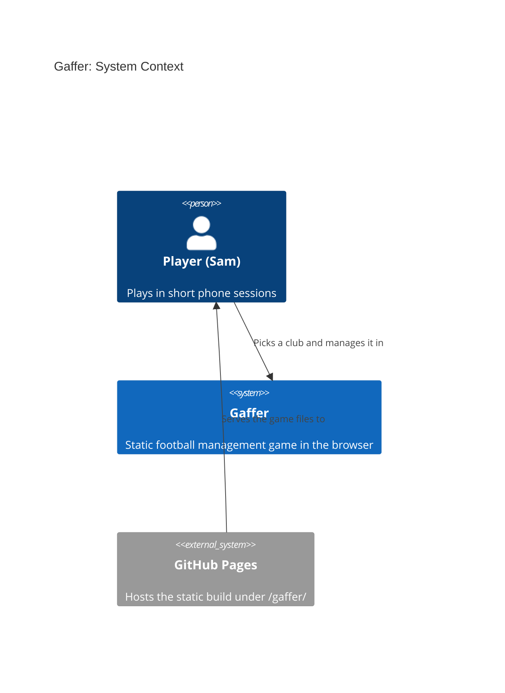
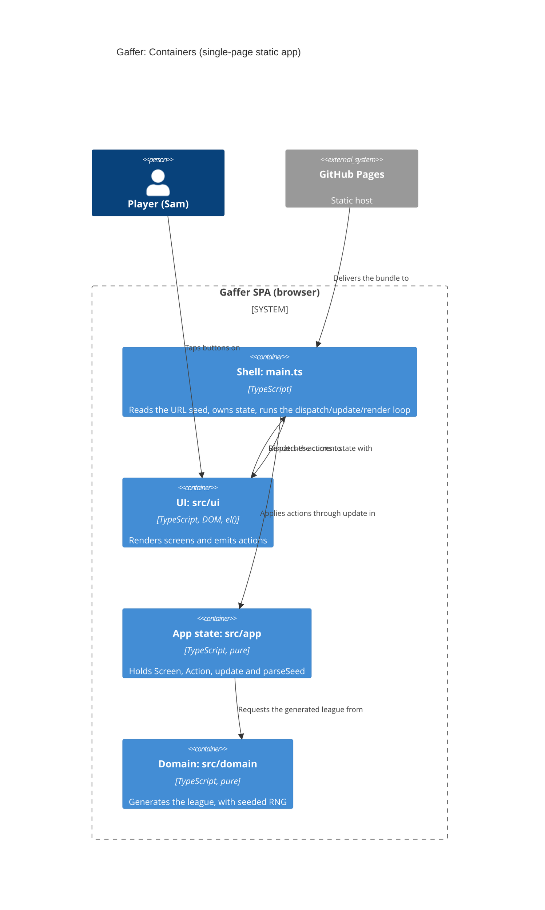

# Gaffer: architecture brief

SSOT for architecture. Decisions live in `adr-0001..0006`; this file shows how they fit together. Extend it per story.

## Application Architecture

### Drivers and constraints
Quality attributes, in order: determinism and replayability, phone usability and accessibility, testability, small bundle, simplicity. Bundle budget: no runtime dependencies; JS under 50 kB gzip (not yet enforced by CI; deferred).
Constraints: static site under `/gaffer/`, no backend, one solo team (no Conway conflict), OSS only (TypeScript, Vite, Vitest, fast-check, Playwright, oxlint, Stryker: all MIT or Apache-2.0).

### Style (ADR-0003)
Modular monolith, run as a functional core and imperative shell. This is the functional paradigm, and it is recorded here and in ADR-0003, not in CLAUDE.md.
Ports and adapters, in function-signature form:
- `src/domain/` is the pure core. Readonly data, no DOM, clock, storage, `Math.random` or `Date`. Randomness comes only from `rng.ts`.
- `src/app/` is the pure shell state: `GameState`, `Screen`, `Action`, `update`, `parseSeed`.
- `src/ui/` holds the effectful DOM renderers, built with `el()` (ADR-0002).
- `src/main.ts` is the composition root. It reads `location.search` once, owns the current state, and runs the loop `dispatch` then `update` then `render`.
- Dependencies point inward only: ui, then app, then domain.

Rejected simpler alternative: no layering, with generation inline in the UI. It breaks Node-only property tests and determinism checks.

### Effect isolation (contract shapes)
| Component | Shape | Universe / assertion |
|---|---|---|
| `generateLeague`, `generateSquad`, `deriveOverall` (S-003), `createRng`, `nextFloat`, `deriveSeed` | pure, return-only | Deep-equal on repeat calls; input never mutated; fast-check property tests |
| `parseSeed`, `update` | pure, return-only | Unit tests; `update` returns a new state and never mutates the old one |
| `domain/names.ts` | pure data constants, return-only | Frozen word lists, towns, suffixes, palette; no functions with effects. Unit test: no duplicates in name/town lists |
| `ui/dom.ts` `el()` | bounded-change | Creates detached nodes only; never touches `document.body` or attached nodes |
| `render<Screen>` (incl. `renderSquad`, `renderPlayer`) | bounded-change | Writes only `root`'s children. Takes `(root, props, dispatch)`, never `window` or `location`. Does not move focus |
| `main.ts` | unbounded shell | Universe: reads `location.search` once; writes only `root`'s children (via render) and focus (the new `<h1>`, `tabindex="-1"`); no other globals. Covered by e2e |

Driving ports that only read expose no write methods: `generateLeague` and `parseSeed` return values and have no setters.

### Earned Trust (probes)
S-001 has no external adapters. The only environment dependency is `location.search`, read once and validated by `parseSeed`, which falls back to the default on any bad input (the probe equivalent: the unit test feeds `abc`, empty, `9999999999`, `1.5`). Storage will need a probe when persistence arrives (its own story).

### Enforcement
`.oxlintrc.json` forbids domain importing app or ui, app importing ui, and DOM/time use in domain. The PR guard rejects `Math.random`, `Date.now` and `new Date(` in `src/domain/`. Stryker mutates `src/domain/**` nightly.

### Domain model (S-001)
- `League`: `{ seed, clubs: readonly [8 Club] }`
- `Club`: `{ id, name, colours: readonly [Colour, Colour] }`; the colours are distinct and come from a fixed palette.
- Name uniqueness: 8 towns drawn without replacement from at least 24, plus a suffix that may repeat (ADR-0004).
- No external integrations, so no contract tests are needed.

### Component inventory (shipped in S-001)
| Component | Layer | Responsibility |
|---|---|---|
| `src/domain/rng.ts` | domain | Seeded draws (`createRng`, `nextFloat`) |
| `src/domain/names.ts` | domain | Frozen word lists: towns, suffixes, palette |
| `src/domain/league.ts` | domain | `generateLeague(seed)`: pure 8-club `League` |
| `src/app/seed.ts` | app | `parseSeed(search)`, `DEFAULT_SEED` |
| `src/app/types.ts` | app | Shared app types |
| `src/app/state.ts` | app | `GameState`, `Screen`, `Action`, `update` |
| `src/ui/dom.ts` | ui | `el()` safe element builder |
| `src/ui/screens/{title,pick-club,club-home}.ts` | ui | `render<Screen>(root, props, dispatch)`; `club-colours.ts` is a shared swatch helper |
| `src/domain/squad.ts` (S-002) | domain | `Player`, `generateSquad(seed, clubIndex)` |
| `src/ui/screens/squad.ts` (S-002, S-003) | ui | `renderSquad`: h1, "Squad" list (each row one button, dispatches `ViewPlayer`), "Back" button |
| `src/ui/screens/player.ts` (S-003) | ui | `renderPlayer`: h1 player name, Position/Age/Overall lines, "Attributes" list, "Condition" line, "Back" button |
| `src/main.ts` | shell | Composition root, loop, focus on new `<h1>` |

### Squad (S-002, ADR-0005)
- Domain: `Player { name, position: GK|DF|MF|FW, age, overall }` (S-003 adds `attributes` and `condition`); `generateSquad(seed, clubIndex) => readonly Player[]` in `src/domain/squad.ts`; `deriveSeed(seed, stream) => number` in `rng.ts`.
- Different players per club by construction: one league-wide draw of 144 names without replacement from `FIRST_NAMES x SURNAMES`, sliced per club (stream `deriveSeed(seed, -1)`). Name-list entries are single words; pools are frozen after S-002 (changes reshuffle all squads). `clubIndex` not an integer 0..7 throws `RangeError`. Quota 2/6/6/4, ages 17-35, overall 1-20 (stored in S-002; derived from attributes since S-003, see below).
- Squad is derived on render from `league.seed` and the club's index; it is not in `GameState`.
- App: `Screen` adds `{ kind: "squad", clubId }`; `Action` adds `ViewSquad` (clubHome to squad) and `Back` (squad to clubHome); both are no-ops from other screens.
- UI: `ui/screens/squad.ts` `renderSquad(root, club, squad, dispatch)`; `club-home.ts` gains a "Squad" button and takes `dispatch`.
- Contract shapes: `generateSquad`, `deriveSeed` pure return-only (deep-equal, property tests); `renderSquad` bounded-change (root's children only); read-only driving ports expose no setters. No new external adapters, so no new probe; the only environment input stays `location.search` (S-001).
- No external integrations, no contract tests. No new C4 container: the existing L2 holds (domain gains `squad.ts`; the "Requests the generated league from" arrow also carries squads).

### Player detail (S-003, ADR-0006)
- Domain: `Player { name, position, age, overall, attributes, condition }`. `attributes` is a readonly record of `goalkeeping | defending | passing | shooting`, integers 1-20; `ATTRIBUTE_ORDER` and `ATTRIBUTE_LABELS` (exported from `squad.ts`) fix the display order and labels. `condition` is an integer percentage, generated 75-100 (`CONDITION_MIN`, `CONDITION_MAX`), constant in this story.
- `overall` is derived, not drawn: `deriveOverall(position, attributes)` = round-half-up of a per-position weighted mean, in integer tenths (GK 7/1/2/0, DF 0/6/3/1, MF 0/2/5/3, FW 0/1/3/6 over goalkeeping/defending/passing/shooting). Weights are non-negative and sum to 10, so `min attribute <= overall <= max attribute`, always within 1-20.
- Generation: the club stream `deriveSeed(seed, clubIndex)` still draws age then a 1-20 internal `quality` (so names, positions, ages and order are unchanged from S-002); attributes (quality plus a position offset plus noise -2..+2, clamped 1-20) and condition come from `deriveSeed(seed, 100 + clubIndex)`, five draws per player. Stream numbers in use: -1 names, 0..7 clubs, 100..107 attributes. Overall values differ from S-002 (no persistence; accepted).
- App: `Screen` adds `{ kind: "player", clubId, playerIndex }`; `Action` adds `{ type: "ViewPlayer", playerIndex }`, valid only from `squad` with a known club and an integer index 0..17, else a no-op. `Back`: player to squad (same club), squad to clubHome; no-op elsewhere. The player is derived on render (`generateSquad(league.seed, clubIndex)[playerIndex]`), not stored.
- UI: squad rows are `<li>` holding one `<button>` (the same four spans, 44px or taller); `renderPlayer(root, { club, player }, dispatch)` in `ui/screens/player.ts`. Label and value read on one line with a single space ("Position GK", "Goalkeeping 14", "Condition 92%"): inline flow only, no flex or grid on the pairs. Any attribute bar is a CSS pseudo-element (no DOM node, no text).
- Contract shapes: `generateSquad`, `deriveOverall`, `update` pure return-only; `renderPlayer`/`renderSquad` bounded-change (root's children only). No new adapters, so no new probe; no new C4 container.

### C4 level 1: System context

### C4 level 2: Container

### Technology
No new technology. ADR-0001 (toolchain), ADR-0002 (plain DOM), ADR-0004 (seed and world), ADR-0005 (squad generation, S-002) and ADR-0006 (attributes, condition, derived overall, S-003) cover it. Decisions live in `adr-0001..0006`.

### Platform handoff notes
No external integrations. No contract tests. The `ci:*` contract is unchanged.

## For Acceptance Designer

Black-box target: `http://localhost:4173/gaffer/` (`ci:serve`). Pin the seed with `?seed=<int>`.

### Driving ports (S-001)
1. **Domain: `generateLeague(seed: number) => League`** (pure, `src/domain/`).
   - For any 32-bit seed: 8 clubs, unique non-empty names, 2 distinct colours each.
   - The same seed gives deep-equal output. Seeds 1 and 4242 differ.
   - No name is on the real-club denylist (`tests/unit/fixtures/real-club-denylist.ts`).
2. **Shell: seed parsing, `parseSeed(search: string) => number`** (pure, `src/app/`).
   - `^-?\d{1,10}$` within signed 32-bit: used as is, and `007` gives 7.
   - Missing, empty, `abc`, `1.5` and `9999999999` give `DEFAULT_SEED`.
   - Shell: `update(state, action) => state` with `Screen` = `title | pickClub | clubHome{clubId}`. "New game" moves title to pickClub. "Choose club" moves pickClub to clubHome. The chosen club is in memory only.
3. **UI: DOM via roles and accessible names** (Playwright, Pixel 7 / 390px viewport).

### UI contract
| Screen | Contract |
|---|---|
| Title | One `<h1>` "Gaffer"; `button` named "New game" |
| Pick club | One `<h1>` "Choose your club"; a `list` named "Clubs" (`aria-labelledby` on the h1) with exactly 8 `listitem`s, each holding exactly 1 `button`. The first line of the button text is the club name; the swatch is `aria-hidden`. Buttons are 44px or taller. |
| Club home | One `<h1>` containing the chosen club's name |

Cross-cutting: the shell (`main.ts`, not the renderers) moves focus to the new `<h1>` (`tabindex="-1"`) after navigation. There is no horizontal scroll at 390px and no console errors. Generated text is set with `textContent`, never `innerHTML`.

### Driving ports (S-002)
4. **Domain: `generateSquad(seed: number, clubIndex: number) => readonly Player[]`** (pure, `src/domain/squad.ts`); `clubIndex` 0..7, else `RangeError`.
   - 18 players: exactly 2 GK, 6 DF, 6 MF, 4 FW, in that position order. `age` integer 17-35 (accept 16-40 in UI), `overall` integer 1-20.
   - Same `(seed, clubIndex)` gives deep-equal output. Across `clubIndex` 0..7 of one seed all 144 names are distinct; names have no digits.
   - No name in the pool is on the real-player denylist (`tests/unit/fixtures/real-player-denylist.ts`).
5. **Domain: `deriveSeed(seed: number, stream: number) => number`** (pure, `rng.ts`): signed 32-bit integer, deterministic, differs across streams for typical seeds.
6. **Shell: `update`** with `Screen` adding `squad{clubId}`; `ViewSquad` moves clubHome to squad, `Back` moves squad to clubHome (same `clubId`). Both leave state unchanged from any other screen.
7. **UI** (roles and accessible names, 390px):

| Screen | Contract |
|---|---|
| Club home | Adds a `button` named "Squad" (44px or taller); `<h1>` is still the club name |
| Squad | One `<h1>`; `<h1>` text = the club name; a `list` with `aria-label="Squad"` and exactly 18 `listitem`s ~~, not buttons~~ (superseded by S-003, ADR-0006: each listitem holds exactly one `button`, 44px or taller); row text order: name, position, age, overall (age and overall are the first two numbers); `button` named exactly "Back" (44px or taller) returns to club home |

### Driving ports (S-003)
8. **Domain: `generateSquad(seed, clubIndex) => readonly Player[]`** (extended; same signature and `RangeError` rule as port 4).
   - Everything in port 4 still holds, except `overall` is derived. Each `Player` also has `attributes` (keys `goalkeeping`, `defending`, `passing`, `shooting`, each an integer 1-20) and `condition` (integer; generated 75-100, so always within 0-100).
   - `overall` equals `deriveOverall(position, attributes)` and `min(attributes) <= overall <= max(attributes)`; it is an integer 1-20.
   - Same `(seed, clubIndex)` gives deep-equal output, attributes and condition included. Names, positions and ages for a seed are the same as in S-002 (ADR-0006 determinism note). The 18 players of one squad do not all share the same attribute values (property over many seeds and clubs).
   - `ATTRIBUTE_ORDER` is `goalkeeping, defending, passing, shooting`; `ATTRIBUTE_LABELS` are `Goalkeeping`, `Defending`, `Passing`, `Shooting`. `deriveOverall(position, attributes) => number` is pure and exported.
9. **Shell: `update`** with `Screen` adding `player{clubId, playerIndex}`; `Action` adding `ViewPlayer{playerIndex}`.
   - `ViewPlayer` moves squad to player (same `clubId`, given `playerIndex`) only when the club is known and `playerIndex` is an integer 0..17; otherwise state is unchanged (also unchanged from title, pickClub, clubHome and player).
   - `Back` moves player to squad (same `clubId`) and squad to clubHome; from the player screen with an unknown club or an invalid index, and from title/pickClub/clubHome, it leaves state unchanged. No input is mutated.
10. **UI** (roles and accessible names, 390px):

| Screen | Contract |
|---|---|
| Squad rows (S-003) | In the list "Squad": 18 `listitem`s, each holding exactly 1 `button`, 44px or taller. Button text is name, position, age, overall as before (age and overall the first two numbers). Tapping row N opens that squad's player N |
| Player | Exactly one `<h1>`: the player's name (focused after navigation). Visible lines "Position GK|DF|MF|FW", "Age N", "Overall N", each label and value reading together on one line, values equal to the tapped row. A `list` named "Attributes" with exactly 4 `listitem`s, "Goalkeeping N", "Defending N", "Passing N", "Shooting N" in that order, N an integer 1-20 and no other number in the item. Outside that list, "Condition N%" (integer 0-100). `overall` is between the lowest and highest N. A `button` named exactly "Back" (44px or taller) returns to the same club's squad (heading = club name, 18 rows); "Back" there returns to club home. Same seed, club and row give an identical screen on every visit |

Cross-cutting (unchanged): no horizontal scroll at 390px (long names wrap), no console errors, generated text via `textContent`.

### Observable acceptance (behavioural)
- S-003: from the squad, tapping any of the 18 rows opens a screen whose only heading is the player's name, with Position/Age/Overall equal to the row, a list "Attributes" of Goalkeeping, Defending, Passing, Shooting (1-20, in order, no other number), "Condition N%" outside it, and overall within the lowest and highest attribute; "Back" returns to the same squad (18 rows) and "Back" again to club home; the same `?seed=` and row give an identical screen; the 18 players do not all share attributes; `?seed=abc`, 8th club, first row (GK) and last row (FW) both open; each row has exactly one button of 44px or more; no sideways scroll or console errors at 390px; Squad to player is 1 tap and back is 1 tap.
- S-002: club home to "Squad" shows 18 rows; every row is name, position in GK/DF/MF/FW, age 16-40, overall 1-20; the quota is 2/6/6/4; two clubs of one league share no name; `?seed=31` twice gives identical rows in identical order; "Back" shows the club name as heading; no horizontal scroll or console errors at 390px; Squad is reached in 1 tap from club home.
- S-001 (below):
- Title to "New game" shows the heading and the 8-club list.
- Tapping any club (all 8, not a sample) gives an `<h1>` containing its name.
- The same `?seed=` on two fresh visits gives identical lists; seeds 1 and 4242 give different lists.
- An invalid seed gives the same list as no seed (unit-level).
- A tap count of 2 from load to club home.
