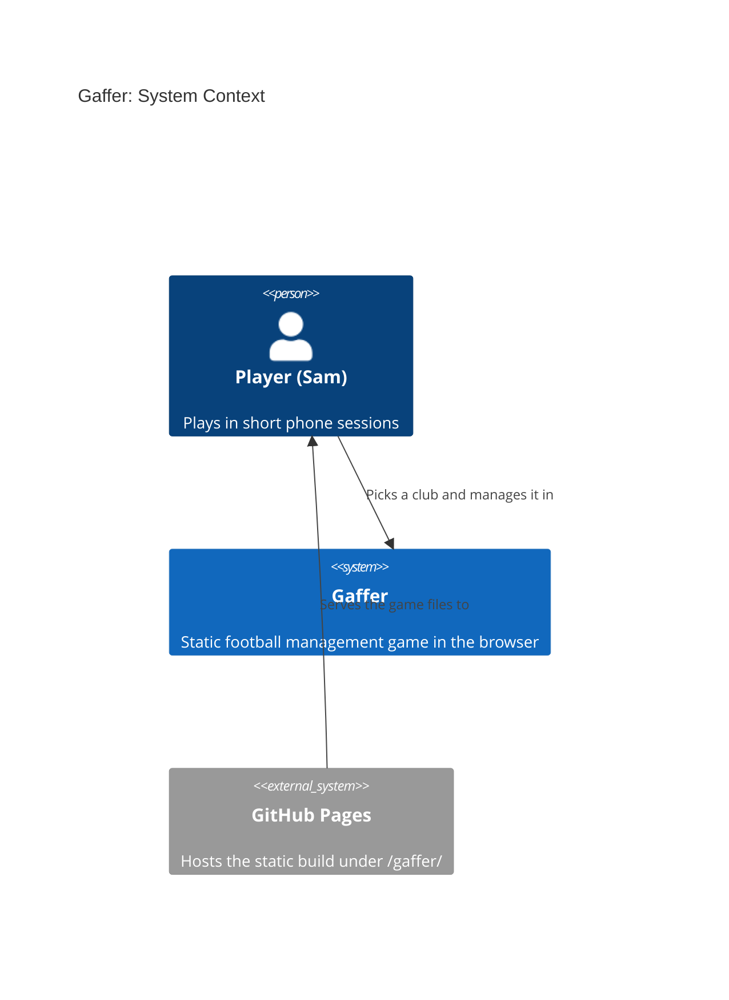
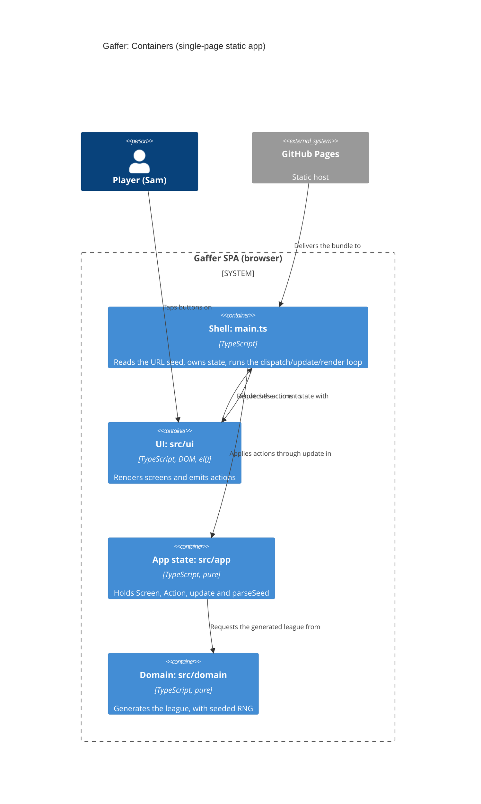

# Gaffer: architecture brief

SSOT for architecture. Decisions live in `adr-0001..0004`; this file shows how they fit together. Extend it per story.

## Application Architecture

### Drivers and constraints
Quality attributes, in order: determinism and replayability, phone usability and accessibility, testability, small bundle, simplicity.
Constraints: static site under `/gaffer/`, no backend, one solo team (no Conway conflict), OSS only (TypeScript, Vite, Vitest, fast-check, Playwright, oxlint, Stryker: all MIT or Apache-2.0).

### Style (ADR-0003)
Modular monolith, run as a functional core and imperative shell. This is the functional paradigm, and it is recorded here and in ADR-0003, not in CLAUDE.md.
Ports and adapters, in function-signature form:
- `src/domain/` is the pure core. Readonly data, no DOM, clock, storage, `Math.random` or `Date`. Randomness comes only from `rng.ts`.
- `src/app/` is the pure shell state: `GameState`, `Screen`, `Action`, `update`, `parseSeed`.
- `src/ui/` holds the effectful DOM renderers, built with `el()` (ADR-0002).
- `src/main.ts` is the composition root. It reads `location.search` once, owns the current state, and runs the loop `dispatch` then `update` then `render`.
- Dependencies point inward only: ui, then app, then domain.

Rejected simpler alternative: no layering, with generation inline in the UI. It breaks Node-only property tests and determinism checks.

### Effect isolation (contract shapes)
| Component | Shape | Universe / assertion |
|---|---|---|
| `generateLeague`, `deriveSeed`, `createRng`, `nextFloat` | pure, return-only | Deep-equal on repeat calls; input never mutated; fast-check property tests |
| `parseSeed`, `update` | pure, return-only | Unit tests; `update` returns a new state and never mutates the old one |
| `render<Screen>` | bounded-change | Writes only `root`'s children and moves focus to the new `<h1>`. Takes `root` and `dispatch`, never `window` or `location` |
| `main.ts` | unbounded shell | The only reader of `location.search`; covered by e2e |

Driving ports that only read expose no write methods: `generateLeague` and `parseSeed` return values and have no setters.

### Earned Trust (probes)
S-001 has no external adapters. The only environment dependency is `location.search`, read once and validated by `parseSeed`, which falls back to the default on any bad input (the probe equivalent: the unit test feeds `abc`, empty, `9999999999`, `1.5`). Storage will need a probe when persistence arrives (its own story).

### Enforcement
`.oxlintrc.json` forbids domain importing app or ui, app importing ui, and DOM/time use in domain. The PR guard rejects `Math.random`, `Date.now` and `new Date(` in `src/domain/`. Stryker mutates `src/domain/**` nightly.

### Domain model (S-001)
- `League`: `{ seed, clubs: readonly [8 Club] }`
- `Club`: `{ id, name, colours: readonly [Colour, Colour] }`; the colours are distinct and come from a fixed palette.
- Name uniqueness: 8 towns drawn without replacement from at least 24, plus a suffix that may repeat (ADR-0004).
- No external integrations, so no contract tests are needed.

### C4 level 1: System context

### C4 level 2: Container

### Technology
No new technology for S-001; ADR-0001 (toolchain), ADR-0002 (plain DOM) and ADR-0004 (seed and world) cover it. No new ADR is needed.

### Platform handoff notes
No external integrations. No contract tests. The `ci:*` contract is unchanged.

## For Acceptance Designer

Black-box target: `http://localhost:4173/gaffer/` (`ci:serve`). Pin the seed with `?seed=<int>`.

### Driving ports (S-001)
1. **Domain: `generateLeague(seed: number) => League`** (pure, `src/domain/`).
   - For any 32-bit seed: 8 clubs, unique non-empty names, 2 distinct colours each.
   - The same seed gives deep-equal output. Seeds 1 and 4242 differ.
   - No name is on the real-club denylist (`tests/unit/fixtures/real-club-denylist.ts`).
2. **Shell: seed parsing, `parseSeed(search: string) => number`** (pure, `src/app/`).
   - `^-?\d{1,10}$` within signed 32-bit: used as is, and `007` gives 7.
   - Missing, empty, `abc`, `1.5` and `9999999999` give `DEFAULT_SEED`.
   - Shell: `update(state, action) => state` with `Screen` = `title | pickClub | clubHome{clubId}`. "New game" moves title to pickClub. "Choose club" moves pickClub to clubHome. The chosen club is in memory only.
3. **UI: DOM via roles and accessible names** (Playwright, Pixel 7 / 390px viewport).

### UI contract
| Screen | Contract |
|---|---|
| Title | One `<h1>` "Gaffer"; `button` named "New game" |
| Pick club | One `<h1>` "Choose your club"; a `list` named "Clubs" (`aria-labelledby` on the h1) with exactly 8 `listitem`s, each holding exactly 1 `button`. The first line of the button text is the club name; the swatch is `aria-hidden`. Buttons are 44px or taller. |
| Club home | One `<h1>` containing the chosen club's name |

Cross-cutting: focus moves to the new `<h1>` after navigation. There is no horizontal scroll at 390px and no console errors. Generated text is set with `textContent`, never `innerHTML`.

### Observable acceptance (behavioural)
- Title to "New game" shows the heading and the 8-club list.
- Tapping any club (all 8, not a sample) gives an `<h1>` containing its name.
- The same `?seed=` on two fresh visits gives identical lists; seeds 1 and 4242 give different lists.
- An invalid seed gives the same list as no seed (unit-level).
- A tap count of 2 from load to club home.
